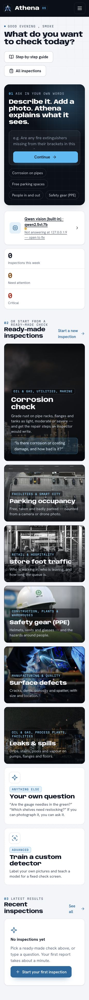
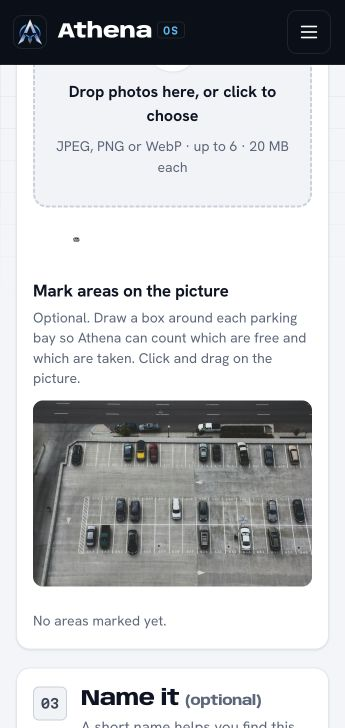
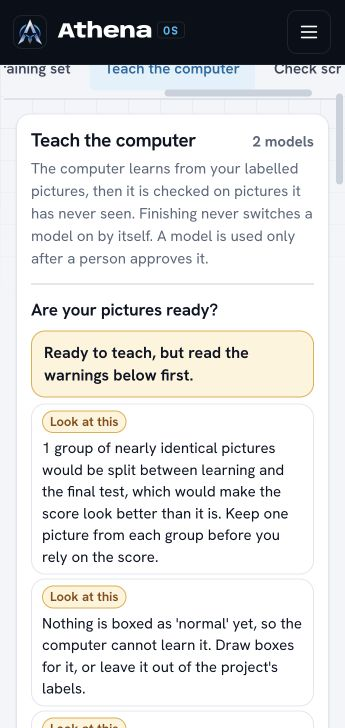
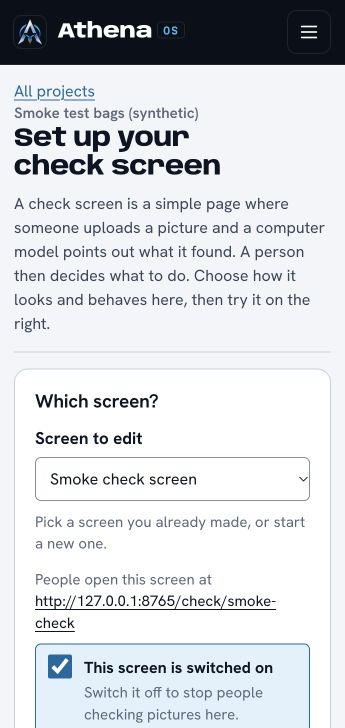

# Athena OS

**Current release: 1.10.2** — the version is declared once in [`web/athena_web/settings.py`](web/athena_web/settings.py) (`RELEASE_VERSION`) and shown in the console sidebar footer, the public [`GET /api/version`](web/projects/views.py) endpoint, and the `/healthz` probe. A deployment may set `ATHENA_VERSION` only to *add* a packaging suffix (for example `1.10.2+acme`); it can never mask the released version.

Athena OS is an open-source (Apache-2.0) toolkit for industrial visual inspection and reviewed
model training. The console home starts with **photo inspections** (ask in plain language or a
ready-made check). **Custom detectors** teach models through task recipes (vision, sound, handwriting,
tables, text, signals, document fields): freeze versioned training sets, train CPU backends, and run
human-gated check screens. A third **people-counting** track covers recorded-video drafts, release
bundles, durable workers, and live RTSP installer preview. It is early: see [`ROADMAP.md`](ROADMAP.md)
for what is done and what is not. This README only claims what the source tree and its tests
demonstrate. The separate [vision-workflow tracker](docs/plans/2026-11-15-vision-workflows-task-list.md)
records locally verified slices and remaining release gates; it is not a production-readiness claim.

The public marketing site is a static React app on the [`landing`](https://github.com/DominicMathew240/Athena-OS/tree/landing) branch (no backend). It deploys to GitHub Pages. This `main` branch is the product source: contracts, SDK, CLI, and the Django console in `web/`.

## Preview: how the system works

The live console is **Athena OS** — light page, white panels, one blue accent from the Athena mark,
Hanken Grotesk, sidebar brand `Athena OS` (see [`docs/design/DESIGN.md`](docs/design/DESIGN.md)).
It is **not** the older “Athena Data Labelling” black-sidebar prototype still present in some
historical dogfood captures under `docs/dogfood/screenshots/`.

Three workspaces share that shell:

1. **Inspect (home)** — ask in plain language, start a ready-made photo check, or open past inspections.
2. **Build → Custom detectors** — recipe projects: add data, label, freeze a training set, teach on CPU,
   approve a candidate, then run a human-gated check screen. Nothing is approved or published automatically.
3. **Build → People counting** — private recorded-video / RTSP-preview operations drafts (in progress).


*Home (current shell). “What do you want to check today?” — photo inspections first; custom model training is a separate advanced path.*


*Photo inspection setup. Mark areas on the picture when a check needs regions (for example parking bays); still frames are not live monitoring.*


*Custom detectors → Teach the computer. A finished run only ever files a **candidate**; the approve gate records the approver and the reason.*


*Check-screen builder. “Not a final decision — the computer's opinion; a person decides.” Feedback is evidence; it never changes the live model by itself.*

**Custom-detector loop (Build → Custom detectors).** Create a project → add data (pictures, WAV, CSV/XLSX, …) →
label (boxes, clip labels, transcripts, field maps; SAM+CLIP suggestions stay **Needs review**) → freeze a
hashed training set → teach on a CPU worker (the web process never loads torch) → approve → check & improve.
Check-screen corrections can be pulled back as Needs-review data for the next round.

**What a first run looks like.** Install, complete first-run setup (first account is administrator), open
home, connect an AI model if you want instant photo inspections, or open **Custom detectors** for the
teach loop. Screenshots above are local prototype captures (synthetic / smoke data), current shell.

### Teaching recipes (`GET /api/recipes`)

Every recipe runs the same guided project → snapshot → teach → candidate → approve lifecycle where a
training backend exists; only what you upload and how you label it changes. Screenshots above are
from the vision recipe. All recipes below are **available** in the registry today and verified on
**synthetic data only** unless noted.

| Recipe key | What you upload | How you label | Backend / outcome |
|---|---|---|---|
| `vision-detection` (default) | JPEG/PNG/WebP | Boxes (+ optional SAM+CLIP suggestions) | `torchvision-fasterrcnn` (CPU); COCO/YOLO export |
| `audio-classification` | WAV clips | One label per clip | `audio-wav-cnn` (ONNX-or-torch artifact) |
| `handwriting-ocr` | Handwriting pictures | Typed transcript per picture | `ocr-trocr` (Microsoft TrOCR fine-tune; admin-gated download) |
| `tabular-prediction` | One CSV/XLSX | Choose the target column | `tabular-sklearn` ensemble |
| `text-classification` | CSV of `{text, label}` | Label column categories | `text-sklearn` (bag-of-words / TF-IDF + linear) |
| `signal-classification` | Wide-format signal CSV | Label column categories | `signal-sklearn` (window stats + linear); forecasting/anomaly out of scope |
| `document-fields` | CSV/XLSX of structured records | Fields as `name:type` (text/number/date) | Rule-based validation + version-to-version table eval — **no trained model** |

Honest limits shared by the non-vision recipes: model quality is unmeasured on real industrial data;
no real-operator usability session has been run; check screens serve **image** models today
(including OCR text answers) — audio, table, text, and signal models cannot sit behind a check
screen yet.

### Operations (people counting, private, in progress)

A second workflow covers recorded-video and live-camera operations: private sites and sources, an
operation draft with a counting line and human reference marks, named polygon bays, and an
immutable, versioned component chain — source view, geometry, recipe, policy, screen, and an
approved-model binding — that can be assembled into an append-only **release bundle** (a release
candidate; full publication/runtime of live counting is not complete).

**What is in 1.7.0–1.10.2 (tree + tests):**

| Slice | What it does | Honest limit |
|---|---|---|
| **Recorded video sources** | Whole-file H.264 MP4 imports with decode validation, private byte storage, checksums, recording clock + ingestion time (`POST /api/operation-sources/<id>/recordings`) | Site-local private storage only |
| **Drafts & geometry** | Guided resumable stepper; counting line; keyboard-accessible geometry; named four-corner bays (T17); localStorage autosave (T15) | Draft cannot publish a live count by itself |
| **T18 + T24–T31 (1.7.0)** | Recorded runtime path, aggregates, parking surfaces, docs/wiki for the operations track | Continuous live counting not enabled |
| **T32 (1.8.0)** | Replay / parking miss diagnosis with a console surface | Diagnostic aid — not a full SOC |
| **T33 (1.10.0 / 1.10.1)** | Event-linked learning examples and verified negatives from diagnosis; content-hash dedupe; owner-scoped capture/list/status APIs | No review-queue UI (T34); no dataset-split wiring (T35); evidence is references only (no frame bytes) |
| **T19 durable workers** | `OperationExecution` jobs; `manage.py operation_worker` / `operation_supervisor`; DB lease, multi-worker safe, crash reclaim, finish-once | Execution step is still a **verified-replay placeholder** (byte-verify recording + replay human reference events) |
| **T23 event ledger** | Append-only `OperationEvent` ledger; idempotent commit; aggregates from raw events | Wired through the worker step for reference events |
| **T10 live RTSP (1.9.0 / 1.9.1)** | Allow-listed `rtsp://` / `rtsps://` probe via ffprobe (TCP, H.264); single JPEG installer preview; credentials via T11 vault (no userinfo in URL); role table includes live-rtsp routes | **No continuous live execution, tracking, or counting from RTSP** |
| **Preflight** | `GET /api/operation-preflight` — video checking, private storage, teaching/check helpers, picture-reading model | Reports gaps; does not invent missing pieces |

Live RTSP config and API: [`docs/guides/live-rtsp.md`](docs/guides/live-rtsp.md). Set
`ATHENA_APPROVED_RTSP_HOSTS` (exact hosts). Empty allow-list refuses every preview.

### Try it locally

```bash
python -m pip install -r web/requirements.txt numpy
python web/manage.py migrate
DJANGO_DEBUG=1 python web/manage.py runserver 127.0.0.1:8000
```

Open <http://127.0.0.1:8000> and complete first-run setup. Full self-hosting guide (TLS, workers,
Docker, S3, live RTSP): [`web/DEPLOYMENT.md`](web/DEPLOYMENT.md). To try the SDK and synthetic pipelines instead:
[`docs/getting-started.md`](docs/getting-started.md).

### What each part is for

| Piece | What it does |
|---|---|
| **Console** (`web/`) | The product shell: Home (inspections), Custom detectors (seven recipes), People counting, AI model settings, Access, Docs. Sign-in; four roles (Viewer, Labeler, Trainer, Approver) enforced server-side on every write. Design: [`docs/design/DESIGN.md`](docs/design/DESIGN.md). |
| **Durable workers** (`web/`) | Training, inference, auto-label and operation-execution workers that run outside the web process, claim jobs atomically, and recover from crashes. See [`web/DEPLOYMENT.md`](web/DEPLOYMENT.md). |
| **Contracts and SDK** (`sdk/python`, `contracts/`) | Versioned Pydantic contracts for observations, assets, models, findings, evidence, policies and actions; generated JSON Schema checked in. Needs Pydantic 2.11+. |
| **CLI and examples** (`cli/`, `examples/`) | Contract validation and synthetic image/audio pipelines. The YOLO example adapter needs `ultralytics` (**AGPL-3.0**) — read the warning in [`docs/getting-started.md`](docs/getting-started.md) first. |
| **Reference connectors** | Folder-drop and HTTP-push connectors with retries, backpressure and an idempotency ledger: [`docs/guides/writing-a-connector.md`](docs/guides/writing-a-connector.md). |

## Versioning

The console follows **semantic versioning** starting at `1.0.0`. The version lives in exactly one
place (`RELEASE_VERSION` in [`web/athena_web/settings.py`](web/athena_web/settings.py)) and is read
through [`athena_web/version.py`](web/athena_web/version.py):

- `GET /api/version` → `{"name": "athena-console", "version": "1.10.2"}` (public; a bug report
  should not need an account)
- `GET /healthz` → the version alongside the database/media readiness checks
- the console sidebar footer → `Athena OS 1.10.2` on every page

Recent console tags on `main` (feature commits):

| Version | Headline |
|---|---|
| **1.10.2** | README preview uses current Athena OS shell (not old Data Labelling dogfood shots) |
| **1.10.1** | CI: T33 role table, migration index names, label gate on learning-example writes |
| **1.10.0** | T33 event-linked learning examples and verified negatives; docs honesty for seven recipes |
| **1.9.1** | T10 live-rtsp routes declared in the role/access table |
| **1.9.0** | T10 live RTSP connect + installer JPEG preview |
| **1.8.0** | T32 replay/parking miss diagnosis console surface |
| **1.7.0** | T18 + T24–T31 recorded runtime, aggregates, parking, operations docs |

The SDK and CLI packages (`athena-sdk`, `athena-cli`) are versioned independently at `0.1.0` in
their own `pyproject.toml` files; they will track the console's major version when their public
contracts stabilise.

## What exists today

- **Athena console** (`web/`, Django): **Athena OS** shell (light theme + optional control-room dark mode), home for photo
  inspections, custom-detector projects across seven recipes, labelling with optional SAM + CLIP suggestions that stay
  **Needs review** until accepted, people-counting drafts, AI model settings, access roles. Self-hosting:
  [`web/DEPLOYMENT.md`](web/DEPLOYMENT.md); developer notes: [`web/README.md`](web/README.md); design contract:
  [`docs/design/DESIGN.md`](docs/design/DESIGN.md).
- **Dataset versioning and export (JSON API plus a "Make a training set" console panel)**: immutable numbered versions of the
  accepted labels/boxes, deterministic train/val/test splits, a hashed manifest, and COCO or YOLO zip export for
  image detection (generic `manifest` export for non-box recipes).
  See [`docs/guides/data-export.md`](docs/guides/data-export.md).
- **Extension contracts (plugin-author guides)**: the modality-plugin, task-recipe and training-backend
  interfaces every data kind runs through — including honest limits (no payload versioning policy yet, no community
  plugin yet). Start at [`docs/guides/extension-overview.md`](docs/guides/extension-overview.md).
- **Teaching, models and check screens (prototype)**: one-button "Teach the computer", CPU backends per recipe,
  model stages with an approval note, check screens for image models, four access roles, and a reviewed path from
  operator corrections back into Needs-review data ([`docs/guides/improve-loop.md`](docs/guides/improve-loop.md)).
  Synthetic-verified; no real-operator usability session. See [`docs/guides/model-quality.md`](docs/guides/model-quality.md).
- **Seven teaching recipes (synthetic-verified)**: vision, audio, handwriting OCR, tabular, text, signal, and
  document-fields — all registered `available: true` via `projects.tasks` / `GET /api/recipes`.
- **Operations track through 1.10.1**: private sites/sources, recorded-video drafts, release-bundle chain,
  durable workers (T19), event ledger (T23), parking/replay diagnosis (T32), event-linked learning examples and
  verified negatives (T33), and live RTSP installer preview (T10). Design notes under [`docs/plans/`](docs/plans/)
  and [`docs/guides/live-rtsp.md`](docs/guides/live-rtsp.md). T33 APIs:
  `POST /api/operation-executions/<id>/learning-examples/capture`,
  `GET/POST /api/operations/<id>/learning-examples`,
  `POST /api/operation-learning-examples/<id>/status`.

## What does not exist yet

Rights/evidence review queues (T34+), a real-operator trace of the correction-to-new-model path, connectors for any
real scanner (only reference connectors exist), measured accuracy on real industrial data for any recipe, continuous
live RTSP counting/tracking/event production, check-screen serving for non-image models, and a full runtime that
publishes and runs operation release bundles beyond verified replay of recorded reference events. Do not treat the
console as a complete production operations stack or a finished dataset manager.

## Licences

Code is Apache-2.0 ([`LICENSE`](LICENSE)); docs are CC-BY-4.0 ([`docs/LICENSE`](docs/LICENSE)). Third-party
notices: [`THIRD_PARTY_NOTICES.md`](THIRD_PARTY_NOTICES.md). Model weights that the auto-labeller downloads have
their own terms, including a caveat on CLIP: see the licence audit and the "Licences and model terms" section of
[`web/DEPLOYMENT.md`](web/DEPLOYMENT.md). The audit is an engineering review, not legal advice.

## Where to start

[`docs/getting-started.md`](docs/getting-started.md), [`docs/architecture-overview.md`](docs/architecture-overview.md),
[`CONTRIBUTING.md`](CONTRIBUTING.md), [`SECURITY.md`](SECURITY.md).
