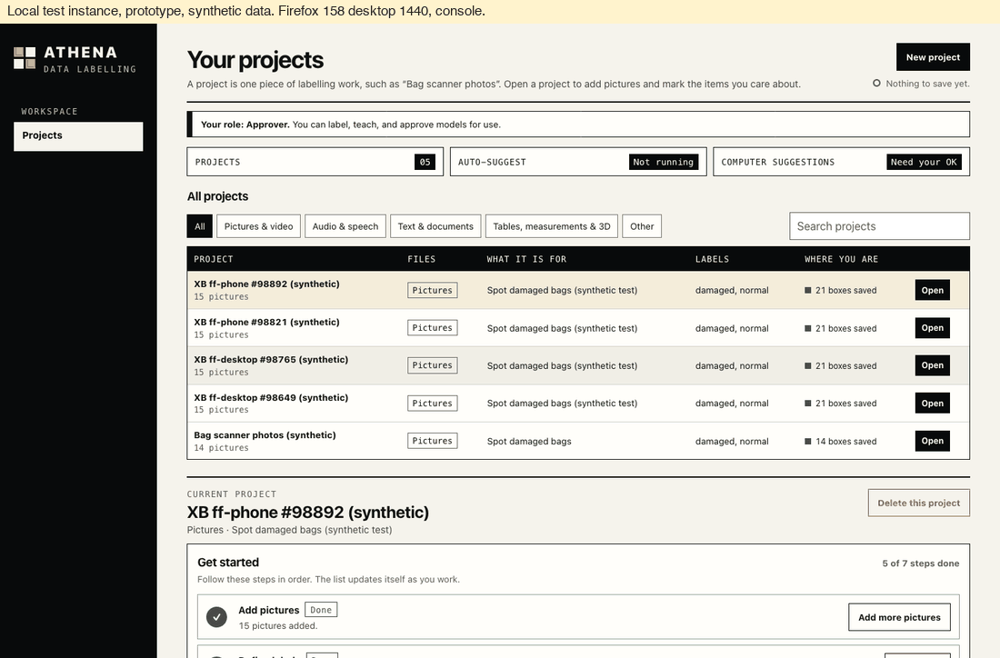
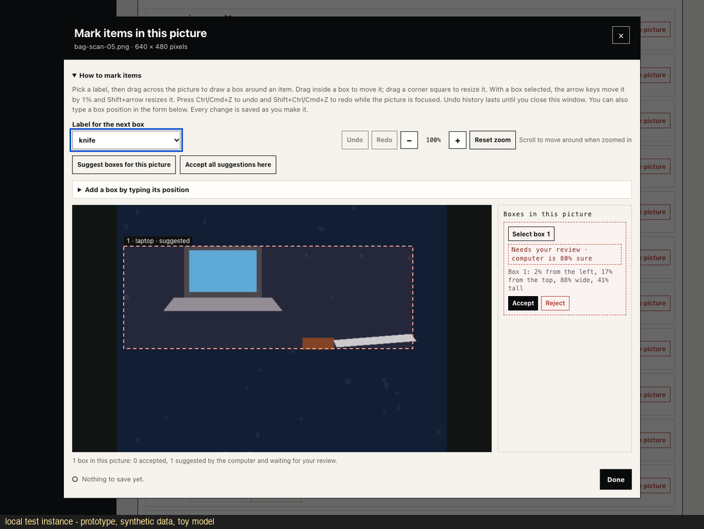
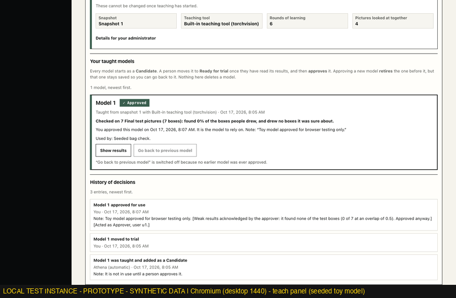
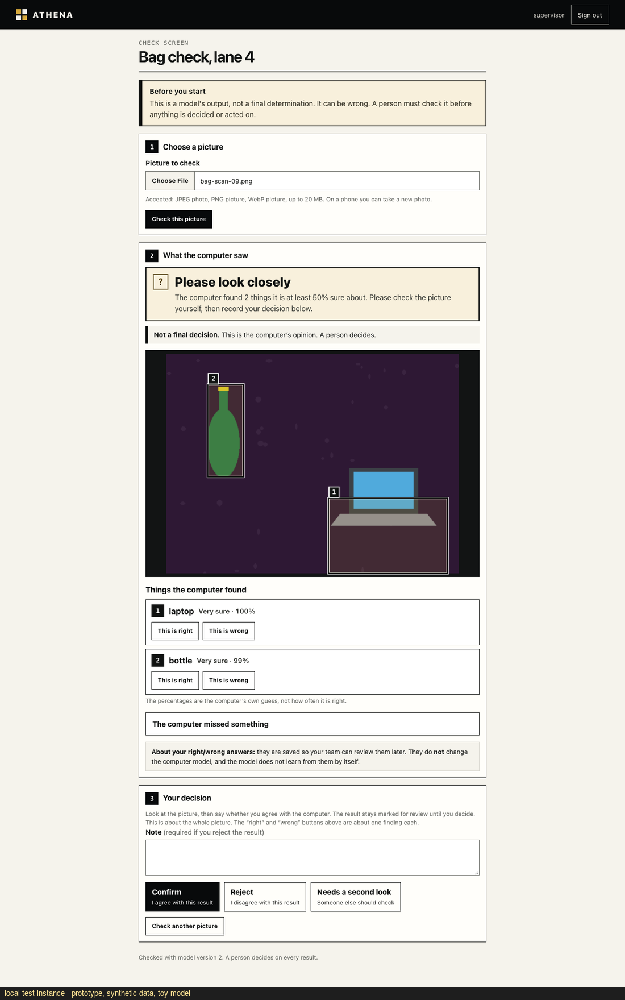

# Athena OS

**Current release: 1.7.0** — the version is declared once in [`web/athena_web/settings.py`](web/athena_web/settings.py) (`RELEASE_VERSION`) and shown in the console sidebar footer, the public [`GET /api/version`](web/projects/views.py) endpoint, and the `/healthz` probe. A deployment may set `ATHENA_VERSION` only to *add* a packaging suffix (for example `1.7.0+acme`); it can never mask the released version.

Athena OS is an open-source (Apache-2.0) toolkit for building reviewed datasets and models for industrial
data. It teaches through four recipes: **vision detection** (draw boxes on pictures), **sound
classification** (label WAV clips), **handwriting OCR** (type what the handwriting says), and
**tabular prediction** (pick a column in a CSV/XLSX file to predict from the others). It is early: see
[`ROADMAP.md`](ROADMAP.md) for what is done and what is not. This README only claims what the source
tree and its tests demonstrate. The separate [vision-workflow tracker](docs/plans/2026-11-15-vision-workflows-task-list.md)
records locally verified slices and remaining release gates; it is not a production-readiness claim.

The public marketing site is a static React app on the [`landing`](https://github.com/DominicMathew240/Athena-OS/tree/landing) branch (no backend). It deploys to GitHub Pages. This `main` branch is the product source: contracts, SDK, CLI, and the Django console in `web/`.

## Preview: how the system works

The console walks a nontechnical operator through six plain-language steps. Each step only becomes
usable when the ones before it have real content, and nothing is ever approved or published automatically.

1. **Create a project** — a goal and the labels for the things you want found.
2. **Add pictures** — JPEG/PNG/WebP, checked and hashed (or WAV clips, or a CSV/XLSX file, depending on the recipe).
3. **Label** — boxes drawn by hand or suggested by SAM+CLIP, always reviewed.
4. **Freeze a training set** — an immutable, numbered, hashed snapshot.
5. **Teach a model** — a CPU training worker; the web process never loads torch.
6. **Check & improve** — a check screen runs new pictures through the approved model; operators mark
   results right or wrong; corrections return as Needs-review pictures for the next teaching round.


*The projects console (a real capture from a dogfood run, Firefox 158). Every step shows its own state; nothing is hidden behind jargon.*


*Step 3, labelling. Auto-suggested boxes always arrive as **Needs review** — nothing becomes ground truth until a person accepts it.*


*Steps 5 and 6. A finished teaching run only ever files a *candidate* model; the approve gate records the approver and the reason.*


*The check screen (step 6). "Not a final decision. This is the computer's opinion. A person decides." Feedback is saved as evidence; it never changes the model by itself.*

**What a first run looks like.** Install, run first-run setup (the first account becomes the
administrator), and the console opens on a plain-language checklist: create a project, add pictures,
draw boxes around the things you want found, save a training set, teach the computer, check the
results. Check-screen corrections are kept as evidence and can be pulled back into the project for
the next round — the live model is never changed by feedback alone.

### The four teaching recipes

Every recipe runs the same guided project → snapshot → teach → candidate → approve lifecycle; only
what you upload and how you label it changes. The screenshots above are from the vision recipe; the
three newer recipes (audio, OCR, tabular) use the same guided steps, and no real capture of them is
published yet.

- **Recognize objects in pictures** (`vision-detection`, the default): upload JPEG/PNG/WebP pictures → draw a box around each thing and give it a label → train the `torchvision-fasterrcnn` CPU detector.
- **Recognize sounds or equipment faults** (`audio-classification`): upload WAV clips → give each clip one label (e.g. healthy_motor, bearing_fault) → train the `audio-wav-cnn` CPU backend (ONNX-or-torch artifact).
- **Read handwriting** (`handwriting-ocr`): upload pictures of handwriting → type the corrected text for each picture → fine-tune the `ocr-trocr` reader (Microsoft TrOCR); checked by character and word errors.
- **Predict from a spreadsheet** (`tabular-prediction`): upload one CSV or XLSX file → choose the column to predict (the other columns are the clues) → train the `tabular-sklearn` ensemble (random forest + gradient boosting), scored on held-out rows it has never seen.

**Operations (people counting, private, in progress).** A second workflow is being built for
recorded-video operations: private sites and sources, an operation draft with a counting line and
human reference marks, and an immutable, versioned component chain — source view, geometry, recipe,
policy, screen, and an approved-model binding — that can be assembled into an append-only **release
bundle** (a release candidate; publication and runtime are not built yet). Durable source
imports are here: a `recorded_video` source can hold whole-file H.264 MP4 recordings —
validated with a real decode pass, kept privately byte-for-byte with their checksum, the
recording's own clock and the ingestion time (`POST /api/operation-sources/<id>/recordings`).
The console walks an operator through this as a guided, resumable stepper, and an environment
preflight (`GET /api/operation-preflight`) says up front whether the server can actually run an
operation — video checking, private storage, the teaching and check-screen helpers, and the
picture-reading model — with the person responsible and one recovery step for each missing part.
Durable execution workers are here (T19, [`docs/plans/2026-11-19-t19-durable-workers.md`](docs/plans/2026-11-19-t19-durable-workers.md)):
an API call files an `OperationExecution` job, and `manage.py operation_worker` claims it through a
database lease — multiple workers are safe, a crashed worker's job is reclaimed by lease expiry, and
a finished execution can never run twice. The execution step itself is deliberately minimal today
(it byte-verifies the pinned recording and replays the recorded human reference events — a
verified-replay placeholder); T10 (live camera) builds the real capture loop on it. Today a draft
cannot count people, and publication/runtime of release bundles is still not built.

### Try it locally

```bash
python -m pip install -r web/requirements.txt numpy
python web/manage.py migrate
DJANGO_DEBUG=1 python web/manage.py runserver 127.0.0.1:8000
```

Open <http://127.0.0.1:8000> and complete first-run setup. Full self-hosting guide (TLS, workers,
Docker, S3): [`web/DEPLOYMENT.md`](web/DEPLOYMENT.md). To try the SDK and synthetic pipelines instead:
[`docs/getting-started.md`](docs/getting-started.md).

### What each part is for

| Piece | What it does |
|---|---|
| **Console** (`web/`) | The product: sign-in, projects in four recipes (vision detection, sound classification, handwriting OCR, tabular prediction), labelling, review, dataset versions, teaching, check screens, four access roles (Viewer, Labeler, Trainer, Approver) enforced server-side on every write. |
| **Durable workers** (`web/`) | Training, inference, auto-label and (since T19) operation-execution workers that run outside the web process, claim jobs atomically, and recover from crashes. See [`web/DEPLOYMENT.md`](web/DEPLOYMENT.md). |
| **Contracts and SDK** (`sdk/python`, `contracts/`) | Versioned Pydantic contracts for observations, assets, models, findings, evidence, policies and actions; generated JSON Schema checked in. Needs Pydantic 2.11+. |
| **CLI and examples** (`cli/`, `examples/`) | Contract validation and synthetic image/audio pipelines. The YOLO example adapter needs `ultralytics` (**AGPL-3.0**) — read the warning in [`docs/getting-started.md`](docs/getting-started.md) first. |
| **Reference connectors** | Folder-drop and HTTP-push connectors with retries, backpressure and an idempotency ledger: [`docs/guides/writing-a-connector.md`](docs/guides/writing-a-connector.md). |

## Versioning

The console follows **semantic versioning** starting at `1.0.0`. The version lives in exactly one
place (`RELEASE_VERSION` in [`web/athena_web/settings.py`](web/athena_web/settings.py)) and is read
through [`athena_web/version.py`](web/athena_web/version.py):

- `GET /api/version` → `{"name": "athena-console", "version": "1.7.0"}` (public; a bug report
  should not need an account)
- `GET /healthz` → the version alongside the database/media readiness checks
- the console sidebar footer → `Athena OS 1.7.0` on every page

The SDK and CLI packages (`athena-sdk`, `athena-cli`) are versioned independently at `0.1.0` in
their own `pyproject.toml` files; they will track the console's major version when their public
contracts stabilise.

## What exists today

- **Athena console** (`web/`, Django): sign-in, project registry, a plain-language console, JPEG/PNG/WebP image
  import with checksums, a label editor, manual bounding boxes, and optional SAM + CLIP auto-suggested boxes that
  stay **Needs review** until a person accepts them. Self-hosting guide: [`web/DEPLOYMENT.md`](web/DEPLOYMENT.md);
  developer notes: [`web/README.md`](web/README.md).
- **Dataset versioning and export (JSON API plus a "Make a training set" console panel)**: immutable numbered versions of the
  accepted boxes, deterministic train/val/test splits, a hashed manifest, and COCO or YOLO zip export.
  See [`docs/guides/data-export.md`](docs/guides/data-export.md).
- **Extension contracts (plugin-author guides, M1)**: the modality-plugin, task-recipe and training-backend
  interfaces every data kind runs through, documented for plugin authors — including the honest limits (no payload
  versioning policy yet, no community plugin yet). Start at
  [`docs/guides/extension-overview.md`](docs/guides/extension-overview.md).
- **Teaching, models and check screens (prototype)**: a one-button "Teach the computer" part that trains a CPU detector from a
  ready-made starting model (`torchvision-fasterrcnn` by default; a `dfine-coco` backend is opt-in), a picture check,
  plain-language results, model stages with an approval note, check screens that run an
  image through the approved model, and four access roles. Operator corrections from check screens can be pulled back into a project as pictures with
  **Needs review** boxes and a new model compared with the one in use ([`docs/guides/improve-loop.md`](docs/guides/improve-loop.md)); nothing changes a model by
  itself. Tested on synthetic data and a toy model only; a usability session with
  real operators has not been run. See [`docs/guides/model-quality.md`](docs/guides/model-quality.md) for what was measured and what was not.
- **Operation drafts and release bundles (API only)**: private sites/sources/operations, recorded-video drafts with a counting
  line and reference marks, and the immutable component-version chain described above. Verified by
  tests and an end-to-end API walkthrough; no console UI, no runtime, nothing published.
- **Multimodal teaching (2026-11 foundation, synthetic-verified)**: a task-recipe
  registry (`GET /api/recipes`) and modality plugins carry four teaching recipes — **vision
  detection** (the original), **audio classification** (upload WAV clips, label each clip, freeze a
  dataset version, train the `audio-wav-cnn` CPU backend; ONNX-or-torch artifact), **handwriting
  OCR** (upload pictures of handwriting, type the corrected text, train the `ocr-trocr` backend that
  fine-tunes Microsoft's published TrOCR reader with admin-gated, checksum-pinned downloads; the
  ~258 MB starting model must be downloaded by an administrator; character-error-rate evaluation),
  and **tabular prediction** (upload one CSV or XLSX file, choose the target column — the labels are
  the file's columns — train the `tabular-sklearn` random-forest + gradient-boosting ensemble, and
  score it on held-out rows it has never seen). All four run through the same
  project/snapshot/run/candidate/approve lifecycle as vision. The audio and tabular recipes have
  also been walked end-to-end with live `curl` against a real server to approved models. Honest
  limits: all four recipes are verified on generated data only (sine tones, generated "handwriting"
  PNGs, synthetic tables); model quality is unmeasured, no real recording, scan or business
  spreadsheet has been taught, and no real-operator usability session has been run. See the 2026-11-19 note in
  [`ROADMAP.md`](ROADMAP.md) M3.
- **Durable operation-execution workers (T19)**: the `OperationExecution` job table (migration 0027),
  `POST /api/operation-release-bundles/<id>/executions`, and `manage.py operation_worker` /
  `operation_supervisor` — lease-based claiming that is safe with multiple workers, expiry-based
  recovery, and a finish-once guard. The execution step is a verified-replay placeholder (see the
  operations paragraph above); T10 (live camera) builds on it next. Design record:
  [`docs/plans/2026-11-19-t19-durable-workers.md`](docs/plans/2026-11-19-t19-durable-workers.md).

## What does not exist yet

Rights/evidence review, a real-operator trace of the correction-to-new-model path (the pieces exist as a prototype: see
[`docs/guides/improve-loop.md`](docs/guides/improve-loop.md)), connectors for any real scanner (only reference connectors exist),
any measured accuracy on real imagery for the trained detector, auto-labelling, the audio classifier, the handwriting reader or
the spreadsheet predictor (all four recipes are synthetic-verified only; model quality is unmeasured), a real-operator usability
session, check-screen serving for audio and table models (check screens serve image models today — including text answers for the
OCR reader — but an audio or table model cannot be put behind a check screen yet), and any runtime that executes an operation
release bundle (the T19 worker replays recorded reference events; it does not run live video). Do not treat the console as a
complete dataset manager.

## Licences

Code is Apache-2.0 ([`LICENSE`](LICENSE)); docs are CC-BY-4.0 ([`docs/LICENSE`](docs/LICENSE)). Third-party
notices: [`THIRD_PARTY_NOTICES.md`](THIRD_PARTY_NOTICES.md). Model weights that the auto-labeller downloads have
their own terms, including a caveat on CLIP: see the licence audit and the "Licences and model terms" section of
[`web/DEPLOYMENT.md`](web/DEPLOYMENT.md). The audit is an engineering review, not legal advice.

## Where to start

[`docs/getting-started.md`](docs/getting-started.md), [`docs/architecture-overview.md`](docs/architecture-overview.md),
[`CONTRIBUTING.md`](CONTRIBUTING.md), [`SECURITY.md`](SECURITY.md).
