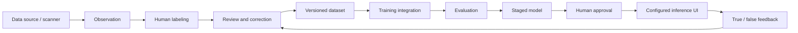
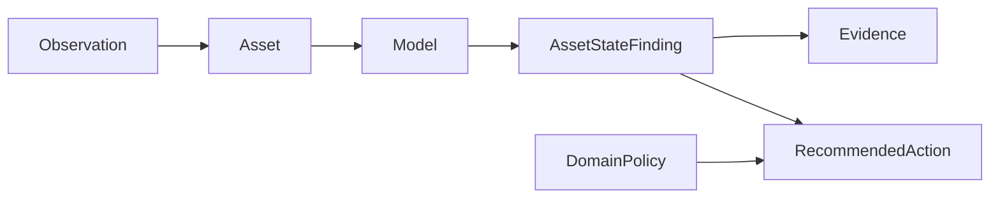

# Athena Open Source architecture

Athena OS is intended to be an open industrial data workflow platform: project setup, human annotation and review, dataset versioning, training/evaluation integrations, and configurable interfaces for real-world inference. The current tree has a Django web app for local project metadata and validated JPEG/PNG/WebP image imports with SHA-256 hashes, but not the complete graphical platform. See the [roadmap](../ROADMAP.md) for implementation status.

## Design principle: open core workflows and explicit plugin boundaries

The open-source product is meant to be usable without a proprietary Athena account or managed service. The current repository provides:

- **Core contracts** — versioned schemas for observations, assets, models, findings, evidence, domain policies, and actions.
- **SDK interfaces** — extension surfaces for model adapters, inference clients, runtimes, registries, domain packs, and evaluation.
- **Reference examples** — synthetic vision/audio flows and adapters that demonstrate the interfaces.
- **CLI and documentation** — developer setup, contract checks, examples, and extension guides.

The web app currently supports project metadata and local image-file imports. Imported files remain unreviewed candidates; rights evidence is not captured. These product capabilities are not implemented yet:

- Rights-evidence review, dataset versioning/export, annotation, and review workspaces (the Django asset registry is only a file-import slice).
- Training orchestration and dataset versioning.
- A no-code configurable operator interface for real-world inference.
- Scanner/industrial data-source connectors and deployment packaging.
- Durable true/false feedback, approved retraining, and model-promotion workflows.

Optional managed hosting may exist separately in the future, but the open-source workflows must not depend on it. Third-party packages, pretrained weights, datasets, scanner SDKs, and commercial branding retain their own licenses and are not implied by the Apache-2.0 code license.

## Intended data flow

Feedback returns to a reviewable dataset candidate. It does not update the live model automatically. A model version is promoted only after an explicit review of the new training run and evaluation.

## Existing contract flow

1. An **Observation** is a captured or derived input (image, sensor stream, point cloud, etc.). It is evidence, not a conclusion.
2. An **Asset** is the physical component being inspected.
3. A **Model** identifies an artifact produced by training or conversion.
4. An **AssetStateFinding** records a model assertion about an asset, grounded in observations.
5. **Evidence** retains supporting material by reference.
6. A **DomainPolicy** specializes label taxonomy, severity mapping, and action policy for a domain.
7. A **RecommendedAction** is a traceable policy output, not free-form advice.

These contracts describe inference and evaluation records. They are not yet a dataset/annotation schema; those contracts require separate versioned design before the graphical labeling workflow is built.

## Module map

| Module | Current role | Status |
| --- | --- | --- |
| `athena_sdk.contracts` | Versioned inference/evidence data schemas | Implemented in source |
| `athena_sdk.interfaces.adapter` | Model-adapter contract | Implemented in source |
| `athena_sdk.interfaces.runtime` | Runtime contract and `LocalRuntime` reference | Implemented in source |
| `athena_sdk.interfaces.domain_pack` | Domain-policy extension contract | Implemented in source |
| `athena_sdk.evaluation` | Evaluation interface and metric references | Implemented in source |
| `examples/adapters` | Synthetic/reference model integrations | Implemented in source |
| `web/projects` | Django project registry plus local image asset metadata/storage | Implemented; image-only file import, no annotation or versioned dataset |
| Project/dataset/annotation schemas | Human labeling and versioned data | Planned; contracts not yet frozen |
| Training integration | Reproducible training and evaluation run | Planned |
| Custom inference UI | Operator-configurable real-world frontend | Planned |
| `athena_sdk.connectors` | Vendor-neutral data-source connector contract, folder-watch and HTTP-push reference connectors, console sink ([guide](guides/writing-a-connector.md)) | Implemented in source; **no real scanner or vendor protocol selected or tested**; feedback integration not included |

## Interface boundary

A community or proprietary model can implement `ModelAdapter` to participate in inference. A runtime can dispatch observations to adapters and optionally apply a domain pack. The current interface does not train a model or manage datasets. The roadmap adds explicit training, dataset, connector, and user-interface extension points without changing existing v1 contract semantics.

## Safety and provenance

- Preserve the input observation, annotation, dataset version, model checksum, inference result, and operator feedback lineage.
- The current image importer records source filenames and hashes imported bytes, but stores no rights evidence and cannot qualify assets for export or training.
- Distinguish unknown/low-confidence model output from a confirmed result.
- Make high-impact review and override visible; a model result is not by itself a legal determination.
- Do not silently retrain or replace a model from operator feedback. Require an approved training run and evaluation.
- Keep sample data synthetic unless its rights and safety classification are verified.

## Versioning

- Each current contract carries a `contract_version` discriminator (`"v1"`).
- Optional additions may be minor changes when semantics remain compatible.
- Removing, renaming, narrowing, or requiring fields is breaking and requires a new major contract version; released versions are not edited in place.
- SDK, CLI, and contract packages version independently under semantic versioning.

See [`contracts/README.md`](../contracts/README.md) for the current contract-version policy.