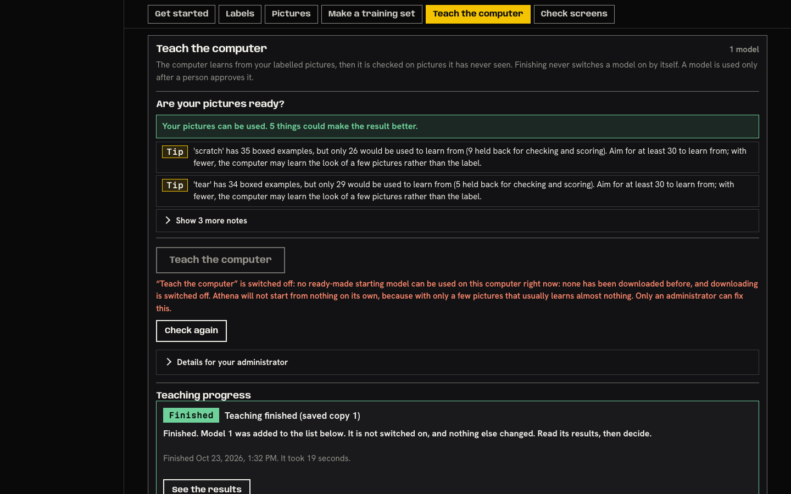
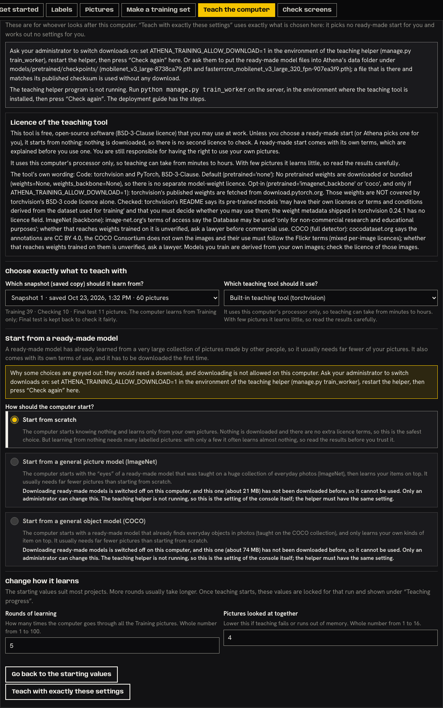
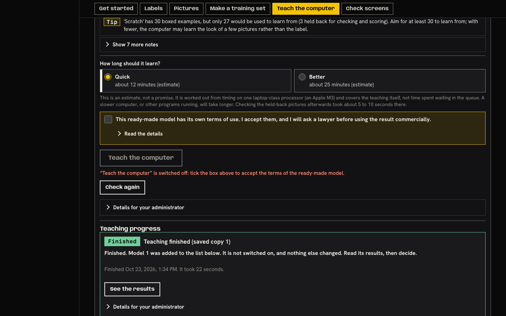
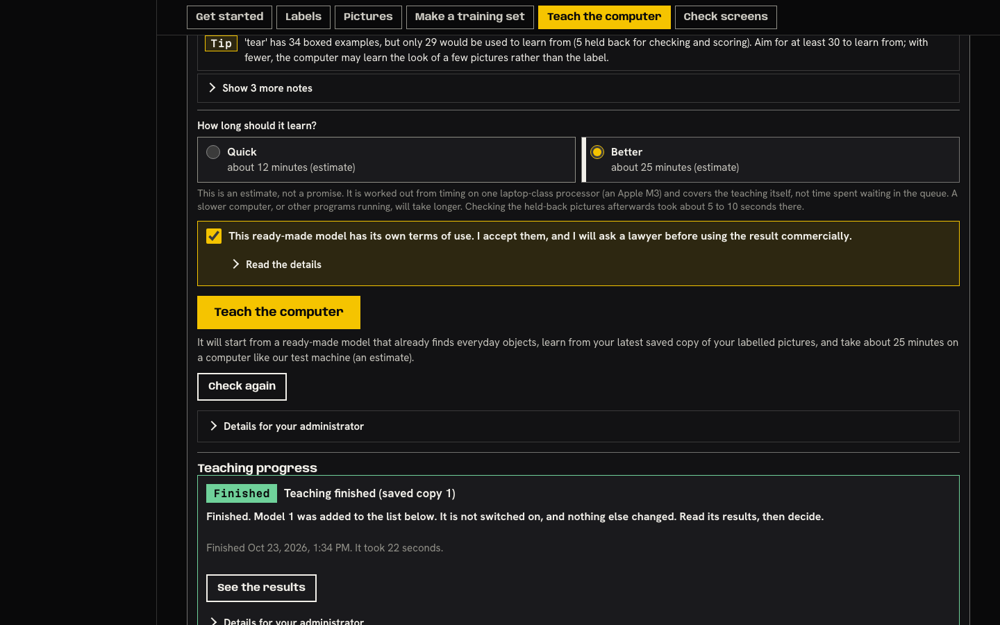
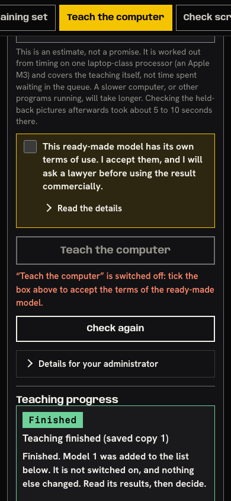
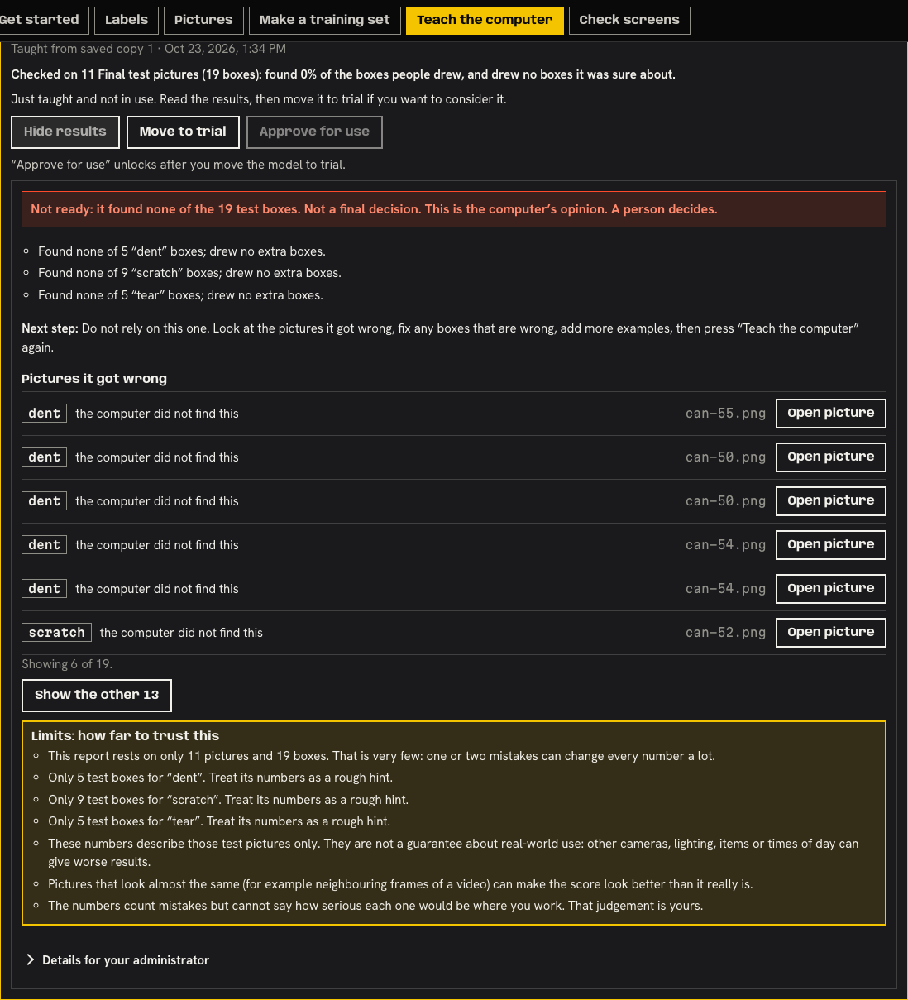
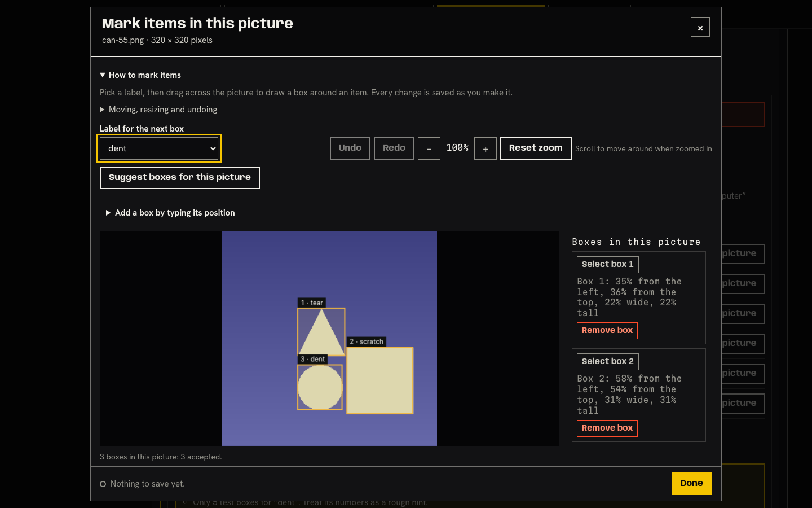
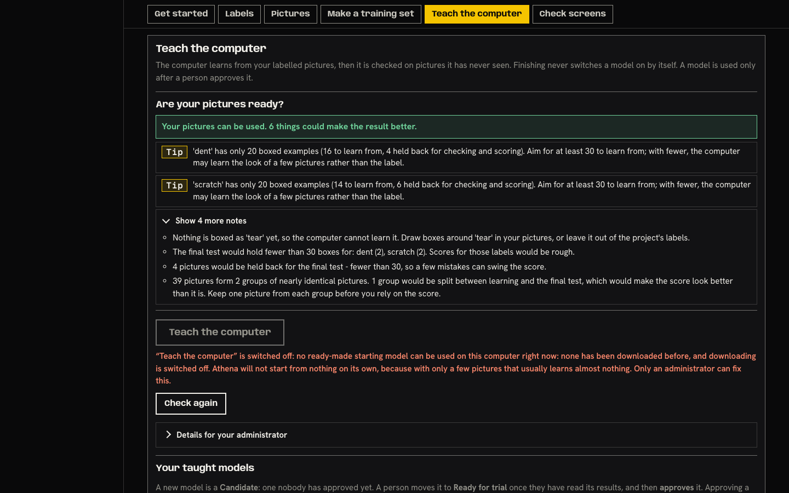

# Teach flow, second persona pass (Rosa): SIMULATED USER, LOCAL PROTOTYPE, SYNTHETIC DATA

**Not a usability session and not evidence for the roadmap gate that needs real operators** (kit: `docs/usability/`).
One scripted persona (Rosa, 57, quality-control supervisor at a canning plant; WhatsApp and Excel; gives up after about 10 seconds of confusion)
driving disposable local instances with made-up pictures. Task: from an opened project with labelled pictures, get a model taught, then
understand whether it is any good. Date 2026-10-23. Earlier pass: `docs/dogfood/2026-10-persona-rosa-layout-pass.md`. Plan: `docs/plans/2026-10-23-no-code-teach-flow.md` section W3-F.

**Target:** disposable Athena console (`runserver --noreload`, DEBUG, loopback), Chromium via Playwright 1.62.1 (headless shell 1248), 1440x900 and 390x844.
**Tester:** Hermes subagent (automated exploratory QA, read-only on product code).

## What is real and what is stubbed (read this first)

| Label | What it means |
|---|---|
| **REAL default** | Seeded project "Dented cans" (60 synthetic pictures, 1 snapshot, one 1-epoch from-scratch model), real server, no ready-made start can run (nothing cached, downloads off), no teaching helper running. This is the state a fresh install is in. |
| **STUBBED** | Same page, but `page.route` answers `…/training/readiness` with the real example body from `b1-evidence/bodies.txt` (COCO + ImageNet "already on this computer"), `…/datasets/health` with `health_example_b2.txt`, the run POST/poll with a queued then finished run, and `…/results/plain` with `b3-partial-response.json` (picture ids remapped to real seeded pictures). Everything a stubbed screenshot shows about timing or numbers comes from those example bodies, not from a run. No ready-made weights were downloaded and no helper ran. |
| **REAL queued** | Runs queued through the administrator's "Teach with exactly these settings" button (the only real path that can queue here); they sit "waiting" because no helper is running. Stopped through the page afterwards. |

A mixed stub card (the stubbed "49 of 60" headline above the real model's "found 0%" line) is an artefact of stubbing only one of the two calls; it is **not** reported as a product contradiction.

## Executive summary

| Severity | Count | Tickets |
|---|---|---|
| Critical | 1 | T1 |
| High | 3 | T2, T3, T4 |
| Medium | 3 | T5, T6, T7 |
| Low (catch-all) | 1 | T8 |
| Feature idea (GREEN) | 1 | T9 |

**Overall assessment:** the rebuilt Teach part is much shorter and plainer (one primary button, 0 form controls before it in the real default, jargon 13 → 2 on first view), and every adversarial move that touches the server held (double click, refresh while queued, stale second tab, viewer, project switch while loading, remembered state). But in the state a fresh install is actually in, **Rosa cannot teach anything**: the button is off and the only way to switch it on is an environment variable on a command-line helper (T1). Once a ready-made start exists, the results card is honest but not yet actionable (T4), and the data checklist still files the two worst data problems under "Tip" (T3).

## Rosa's rant (in character, steps 2-3)

> **Rosa's review of "Athena OS: Teach the computer"**
> Overall: no. Not today. Maybe if somebody else sets it up.
>
> **THE GOOD (grudging):** One big yellow button called "Teach the computer". I like that. It does not ask me what an epoch is. The picture check at the top talks like a person: "'scratch' has 35 boxed examples… aim for at least 30." And when the thing finds nothing it says "Not ready: it found none of the 19 test boxes." At least it does not pretend. It even says "Not a final decision. A person decides." Good, because I decide.
>
> **THE BAD:** I press it and it is grey. Grey! Underneath, in red: "switched off: no ready-made starting model can be used on this computer right now: none has been downloaded before, and downloading is switched off… Only an administrator can fix this." Who is the administrator? Gary from IT, who left in March? I opened "Details for your administrator", like a good girl, and it says to "set ATHENA_TRAINING_ALLOW_DOWNLOAD=1 in the environment of the teaching helper (manage.py train_worker)". Where? In what? There is no button. There is no "Ask Gary" link. I pressed "Check again" three times, the white-bordered one, because it looks more important than the grey one. Nothing happened. Nothing at all. Not even a "still the same".
>
> And on the empty project it tells me "Only an administrator can fix this" while the list above says I have not drawn a single box. Which is it? I can fix one of those. Why is the other one shouting at me?
>
> Then my "dent" has plenty of examples but "tear" has none at all and the green bar still says "Your pictures can be used." The bit about "tear" is hidden behind "Show 4 more notes". That is the one I needed to see!
>
> I got to the results (somebody else's trial run). "Pictures it got wrong". I press "Open picture". I get the whole labelling screen with three boxes on it and nothing saying which one the computer missed. "The computer did not find this." Find WHAT? And it says "Showing 6 of 19" but I only have eleven pictures, and the same can is in the list twice.
>
> The very top of the card says "found 0% of the boxes people drew", then there are three buttons, then a red bar saying more or less the same thing again, but louder.
>
> The tick box: "I accept them, and I will ask a lawyer before using the result commercially." I am a quality supervisor. I am not signing for the company. And when it is not ticked the button message is red, like I did something wrong.
>
> **THE UGLY:** The button does not work, and the instruction for fixing it is a command I cannot type, aimed at somebody I cannot name, in a place it does not say. Back to the clipboard.
>
> **VERDICT:** "It talks nicely, but I still can't make it do anything."

## The pragmatism filter (step 4, out of character)

| # | Complaint | Class | Why |
|---|---|---|---|
| 1 | Button grey; the administrator step is an env var on a command line, no UI, no named place/person | **RED** | A 35-year-old operator hits the same dead end. Rule: a message that tells the user to do something must have a UI path or say exactly where/by whom. Fresh installs ship with downloads off (`web/.env.example`: `ATHENA_TRAINING_ALLOW_DOWNLOAD=0`). → T1 |
| 2 | Red "administrator" sentence wins over the checklist's "Not ready yet" | **RED** | Hides the one thing the user can fix. → T2 |
| 3 | Zero-box label and near-duplicates are only "Tips" under a green bar, folded away | **RED** | Both certainly distort the result (a label with no examples is 0% found; duplicates across train/test inflate the score). → T3 |
| 4 | "Open picture" does not show the miss; list counts boxes as pictures | **RED** | The card's own "Next step" cannot be carried out from the card. → T4 |
| 5 | Two summaries, buttons above the verdict | YELLOW | Duplicate, not contradictory (see check 3). → T5 |
| 6 | Licence tick reads like signing a contract; red when unticked; 312 words of developer text behind "Read the details" | YELLOW (+GREEN) | Server enforces it, so the box stays; the wording and who ticks it are the issue. → T6 |
| 7 | Button is below the first screen | YELLOW | Better than baseline but still 1.03-1.30 screens (desktop) and 1.75-2.33 (phone). → T7 |
| 8 | "Check again" says nothing; Back button; stale tab; exact-settings from scratch; "Good enough" colour | YELLOW | Real, only some users. → T8 |
| 9 | "Why can't I just ask Gary from the screen?" | GREEN | Good idea inside the complaint. → T9 |
| 10 | "Why two choices, Quick and Better, why not one?" | WHITE | Two radios is the stated design; the choice is optional. |
| 11 | "I do not want an estimate in minutes, I want it done" | WHITE | The estimate is labelled an estimate and is the honest thing. |
| 12 | "Too many words on the screen" | WHITE (partly) | Measured: the panel's visible text fell from 571 to 449 words; the tips are the data's words. Jargon is the real metric, and it fell. |
| 13 | "Still a lot of scrolling on the phone" | WHITE | Covered by T7. |

## Measured numbers against the baseline (`baseline.json`)

Same script (`teach_after.mjs`, copied to the QA folder, pointed at my own instances), same viewports. Baseline = the unmodified Teach flow.
"Default" = REAL default, "ready-made" = STUBBED readiness.

| Measure (seeded project) | Baseline | Now: REAL default | Now: STUBBED ready-made |
|---|---|---|---|
| Input events from "project open" to a started run | 2 clicks (chip, Start): but that run started from scratch, which `docs/guides/model-quality.md` says found 0 of 144 test boxes | **impossible** (button off); 1 click gets you to the dead end | 3 clicks + 0 typing (chip, licence tick, Teach). Keyboard only: **24 keys** (16 Tab + Enter to the chip, 3 Tab + Space to the tick, 2 Tab + Enter to the button); focus ring 3 px solid yellow |
| Visible fields before the primary button | 2 fields + 1 button + 4 closed drawers (8 controls inside them) | 0 fields, 0 buttons, 1 drawer ("Show 3 more notes") | 3 (Quick, Better, licence tick) + 2 drawers ("Show 3 more notes", "Read the details") |
| Primary buttons in the Teach part (page-wide) | 2 (3) | **1 (2)** | **1 (2)** |
| Jargon terms on first view (11-term list) | 13 desktop / 13 phone | **2** (both "candidate", the product's own status word) | **2** |
| Jargon with every drawer open | 38 | 19 (21 with the results card open) | 29 (40 in the earlier W2-U stub run) |
| Teach button, distance from page top (cold project, nothing else above) | 1403 px desktop (1.56 screens) / 2203 px phone (2.61) | **902 px (1.00) / 1365 px (1.62)** | n/a (cold has no snapshot) |
| Teach button, seeded (W2-U's run of the same script on a pristine instance; mine read the same 923 and 1175/1941 in `s1`/`s2`) | 1387 px (1.54) / 2216 px (2.63) | 923 px (1.03) / 1475 px (1.75) | 1174 px (1.30) / 1963 px (2.33) |
| Teach panel height, seeded | 2032 / 3382 px | 1530 / 2383 px | 1736 / 2781 px |
| Page height, cold | 2316 / 3808 px | 1970 / 3197 px | n/a |
| Plan sentence vs the button | n/a (no plan sentence) | directly under the button, 8 px gap (the sentence is the red "switched off" reason) | 8 px under the button; 1 line at 1440, 4 lines at 390; both in view when the button is centred |
| Console errors / page errors / failed requests | 0 / 0 / 0 | 0 / 0 / 0 | 0 / 0 / 0 (other than the deliberate 403 / 409 / aborted POST, counted below) |

Note on page height: my re-run of `teach_after.mjs` on the seeded instance read 2968 px because I had added four extra projects to its list for the health checks. That number is not comparable and is not used; the seeded distance row uses W2-U's pristine run.

## What Rosa sees: the eight checks

### 1. REAL default state (screenshots 1 and 2)

- At 1440x900 the first screen holds: the checklist headline (green: "Your pictures can be used. 5 things could make the result better."), two Tips, "Show 3 more notes", the grey button, and the red sentence in plain words. The reason is plain; **who** is plain ("Only an administrator can fix this"); **what** is not.
- `Check again` is the only enabled control and it is the strongest-looking one (white border). Pressing it fires two requests (`readiness`, `health`) and changes nothing visible for the next 900 ms (six snapshots identical, no announcement text): a silent button.
- **Is there any UI path for the administrator step? No.** Grepped `web/projects/templates`, `console.js`, `urls.py`, `settings.py`, `DEPLOYMENT.md`, `.env.example`, `docker-compose.yml`:
  - the step is `ATHENA_TRAINING_ALLOW_DOWNLOAD=1` in the environment of `manage.py train_worker` (it is read from the helper's environment, `torchvision_frcnn.py:134`), or copying two `.pth` files into `<data home>/models/pretrained/checkpoints/`;
  - the nav has "Projects" and (superusers only) "Access"; "Access" manages roles only; there is no settings screen, no toggle, no "send this to my administrator" action;
  - under `docker compose` the helper reads `web/.env` (`env_file: .env`, `docker-compose.yml:42`) and needs `docker compose up -d train_worker`; the panel mentions neither.
- **Where the panel says where/by whom** (screenshot 2, fold opened): "set ATHENA_TRAINING_ALLOW_DOWNLOAD=1 in the environment of the teaching helper (manage.py train_worker), restart the helper, then press 'Check again' here" and, for the stopped helper, "Run `python manage.py train_worker` on the server, in the environment where the teaching tool is installed… The deployment guide has the steps." It labels the audience ("Ask your administrator", the fold title) but not the place (which terminal, which file, Docker or not), not "do not type this into the browser", does not name or link the deployment guide, and does not say where "Athena's data folder" is. `web/DEPLOYMENT.md:190` still describes a collapsed "Advanced: start from a ready-made model" control that no longer exists. **RED dead end (T1).**

- Cold (empty) project, same default: headline "Not ready yet. 1 thing needs fixing first." (no accepted box), but the sentence under the button is the downloads-off one ("Only an administrator can fix this"). Same for the one-picture project. The reason Rosa can act on loses to the one she cannot (T2).
- The opened fold also offers "Teach with exactly these settings", enabled, with "Start from scratch" pre-selected; it queued a real from-scratch run in this environment with no warning next to the button (the radio text says it "often learns almost nothing"). The main button refuses exactly this ("Athena will not start from nothing on its own"). Logged in T8.

### 2. Happy path, STUBBED (screenshots 3, 4, 5)

- Order on screen: checklist, "How long should it learn?" (Quick "about 12 minutes (estimate)", Better "about 25 minutes (estimate)", a three-line grey paragraph about an Apple M3), licence box, button, plan sentence, "Check again", closed administrator fold, then the old "Teaching progress" card.
- **Licence tick, verbatim:** "This ready-made model has its own terms of use. I accept them, and I will ask a lawyer before using the result commercially." plus "Read the details" (312 words: the COCO terms, then the tool's own licence note word for word, which includes `pretrained='none'`, `ATHENA_TRAINING_ALLOW_DOWNLOAD=1`, `BSD-3-Clause`, and a file path `docs/guides/model-quality.md`). The POST carried `{"snapshot":"latest","backend":"torchvision-fasterrcnn","config":{"quality":"quick"},"acknowledge_pretrained_terms":true}`.
- **Plan sentence position:** unticked, the line under the button is the red "switched off: tick the box above to accept the terms of the ready-made model." (reads as an error). Ticked, it becomes: "It will start from a ready-made model that already finds everyday objects, learn from your latest saved copy of your labelled pictures, and take about 25 minutes on a computer like our test machine (an estimate)." (Better selected; 12 minutes for Quick). It sits 8 px under the button at both widths. At 1440x900 the button is at y=1174 (below the first screen, 1.30 screens down); at 390x844 it is at y=1941 (2.3 screens) and the sentence is 4 lines. Both are inside the viewport once the button is scrolled to the middle.
- The sentence does not say that ticking was needed, does not say what "Better" gives beyond time, and never states the ready-made model is licensed separately (the box above does).
- Quick/Better, the tick and the sentence all agree with each other in every state I read (unticked, ticked, Better, back to Quick).

### 3. Results card on a real seeded model (screenshot 6)

- **Two summaries: confirmed.** Top of the card: "Checked on 11 Final test pictures (19 boxes): found 0% of the boxes people drew, and drew no boxes it was sure about." (`trResultSummary`, `console.js:3686`, from the model list's stored evaluation). About 150 px lower, after the three buttons: "Not ready: it found none of the 19 test boxes. Not a final decision. This is the computer's opinion. A person decides." (`.result-headline`, from `/results/plain`).
- **Duplicate, not contradictory:** both say 0 of 19 on 11 pictures; they differ in vocabulary ("drew no boxes it was sure about" vs "drew no extra boxes"). There is no wiring between them, so if the two calls ever disagree nothing reconciles them (the mixed stub shows how that would read: 49 of 60 under "found 0%"). Not seen in real use.
- **Order of trust is right:** measured on this system (the summary, the verdict, the per-label sentences, the miss list, the limits) comes before anything the file or the trainer says about itself; "How this model was taught" and "Limits as the server states them" are last, inside "Details for your administrator". The three buttons (Move to trial, Approve for use) sit above the verdict, and "Move to trial" is enabled under a "Not ready: do not rely on this one" card. Its dialog does lead with "Take care: on the Final test pictures this model found none of the boxes people had drawn."
- **Caption truth sources:** "Checked on 11 Final test pictures (19 boxes)" is the stored held-out evaluation. "Found none of 5 'dent' boxes" is `/results/plain` from the same evaluation (numbers equal). "the computer did not find this" is a box a person drew, in a held-out picture: checked the first six miss rows against the stored accepted annotations of the same pictures through the API: 6 of 6 have the same label and the same box (for example `can-55.png`, dent at 35% from the left, 62% from the top, 21% wide, is `plain.misses.items[0].box` 0.3531, 0.6219, 0.2062). The other 13 rows and the false-alarm captions (only seen in the STUBBED body) are not independently checked.
- **"Pictures it got wrong" counts boxes, not pictures:** "Showing 6 of 19" for 11 test pictures; `can-50.png` and `can-54.png` each appear twice with no way to tell the rows apart. False alarms (the cans it wrongly flags) are sorted after all misses; with the b3 body, three of 14 rows, hidden behind "Show the other 8".

- **"Open picture" opens the full labelling editor** (screenshot 8). Nothing in it marks the missed box (3 boxes on `can-55.png`, none highlighted, no word about the computer's miss); for a false alarm ("the computer drew a box here that is not a dent") nothing is drawn "here". "Next step: Look at the pictures it got wrong, fix any boxes that are wrong…" cannot be carried out from the card (T4).

### 4. Data health (screenshot 7; REAL server, projects built with `seed_extra.py`)

| Project | Headline | Where the worst problem sits | Verdict |
|---|---|---|---|
| Label `tear` with 0 boxes (40 pictures, 2 other labels at 20 boxes) | green, "Your pictures can be used. 6 things could make the result better." | "Nothing is boxed as 'tear' yet, so the computer cannot learn it." is the **first item inside "Show 4 more notes"** (closed) | not a blocker; ready_to_teach true |
| One picture only | blocked state, "Not ready yet. 1 thing needs fixing first." | first line, "Fix this", plain | correct and plain |
| 36 near-duplicate pictures (3 groups of 12) | green, "Your pictures can be used. 5 things could make the result better." | "36 pictures form 3 groups of nearly identical pictures. 3 groups would be split between learning and the final test, which would make the score look better than it is." inside "Show 3 more notes" | detected (3 groups, 3 crossing the split) but filed as a tip |
| Labels with markup (``, `<b>bold</b> & "quotes"`) | as above | shown as literal text, nothing injected, no script ran | pass |
| 200-character label | n/a | **unreachable in the product**: the label box stops at 64 characters and a forged save answers 400 "Label names can be up to 64 characters"; a 64-character unbroken label did not overflow at 1440 or 390. (A 200-character name written straight into the database made the Teach tips run off the card; not reachable by a user, so not ticketed.) | pass |

### 5. Adversarial moves

| Move | Result |
|---|---|
| Double-click Teach | STUBBED with a 900 ms POST: **1 POST**; button disabled, "something is already being taught". REAL exact button: 1 POST, 1 queued run (read back through the API). Pass. |
| Refresh during a queued run | REAL queued: card, locked fields and "Waiting in line, but the helper program is not running. Ask your administrator to start it (the steps are under 'Details for your administrator')" all come back. Pass. Not tested: refresh during a *running* run (no helper). |
| Two tabs | Tab B (opened before the run existed) pressed the exact button: **409**, plain line "Teaching did not start. Something is already being taught for this project. Wait for it to finish, or stop it first." The run list stayed at one queued run. Tab B's card still read "Finished" and its button stayed enabled until a reload (T8). |
| Back button | Part chips do not add history entries. Back after "Check screens" left the page showing the same part and project but the address became `/` (project hash gone), so a reload would drop the project (T8). |
| Long / markup label | See check 4. |
| Project switch while readiness loads | Readiness for project A delayed 4 s and stubbed "ready"; switched to project B (real, downloads off). After the late answer B's button stayed off with its own reason, no A text, no Quick/Better. Pass. |
| Viewer role | Session minted through Django's test client. Button off with "your account can look but not change things. Ask an administrator for the Trainer role.", Quick/Better and tick disabled, exact button disabled, "Check again" and "Show results" enabled, Move/Approve disabled. A forged POST answered **403** with the same plain sentence. Pass. |
| Keyboard only to the button | 24 keys in the STUBBED state; tab order is chip → notes → Quick → tick → "Read the details" → Teach; Space ticks; Enter starts (1 POST). Pass. |

### 6. Jargon (11-term list from `teach_baseline.mjs`, whole-word start)

| Scope | Baseline | Now |
|---|---|---|
| Teach part, drawers closed | 13 | 2 (`candidate` ×2) |
| Teach part, every drawer open | 38 | 19 REAL default (21 with the results card open) / 29 STUBBED |
| Results card, closed | not measured at baseline | 1 (`candidate`) |
| Results card, every drawer open | not measured at baseline | 3 (`snapshot`, `IoU`, `candidate`) |
| Extra developer words on first view of the whole Teach part | not measured | 7 (`retire` ×1, `held back` ×2, `Ready for trial`, `saved copy` ×2, `Final test`); with drawers open 61 (includes `manage.py`, `train_worker`, `ATHENA_`, `torchvision`, `checksum`, `fingerprint`) |

The jargon that is left is in the administrator fold (intended) and in the 312-word licence details (T6). The baseline had no results-card figure to compare, so no before/after is claimed for it.

### 7. Wording that implies the model is accurate or safe

- Real states read (found 0%): none. Every headline carries "Not a final decision. This is the computer's opinion. A person decides."; the Limits block is amber and sits under the list; "Move to trial" says "This only marks the model as worth a closer look."
- **Not exercised on a real model:** the "Good enough to try" verdict (green, `report.py:296`, needs at least 85% found overall and per label, 70% right when it drew boxes, at least 30 test boxes per label). Its next step reads "It is worth a closer look. Move it to trial, check it on a few new pictures from your own work…". That wording is reasonable; the real-world caveat is in the Limits block below the list rather than next to the green headline (T8).
- Checklist wording, "Your pictures can be used" and "Your pictures look ready to teach from", is about the pictures, not the model; it is the same green with a label that has no examples (T3).

### 8. Remembered state

- `console.js` has **zero** `sessionStorage` / `localStorage` references (grep count 0), so nothing about Quick/Better or the tick is remembered by design. I pre-seeded eight plausible keys in both stores ("quality: better", tick off) anyway: no effect.
- Fresh load: Quick, unticked; button off, sentence "tick the box above". Choose Better + tick: button on, sentence "…about 25 minutes…". **Reload:** back to Quick, unticked, button off, sentence "tick the box above" (matches the real control values). Switch part and back: choices kept and sentence matches. Browser Back/forward: reset, matches. A finished run also clears the tick on purpose. No mismatch between chip/sentence and control values found. Pass.

## Issues (ticket-ready, ranked)

### T1 (Critical, RED): the Teach button cannot be switched on from the console, and the step it names is a command-line variable
| Field | Value |
|---|---|
| Category | Content / dead end |
| Where | `#tr-start-help` (reason built by `trOneClickReason`, `console.js:3128`), `#tr-admin-note` (`console.js:2866-2880`), text `AUTO_NONE_STEPS` / `how_to_enable` in `web/projects/training/torchvision_frcnn.py:276`, `web/DEPLOYMENT.md:190` |
| Persona quote | "Where? In what? There is no button." |

Steps: open the seeded project, press the "Teach the computer" chip. Expected: a button that works, or a message with a way to act. Actual: grey button, "Only an administrator can fix this", fold with an environment variable for `manage.py train_worker`; no setting, toggle or contact anywhere in the console; fresh installs ship with downloads off.
Fix (pick; do not just reword): (a) put the action in the panel: an administrator-only control (Access screen or the fold) that records the choice and tells the helper, or ship the two weight files so no switch is needed; (b) minimum: label the steps by place and person ("Whoever installed Athena, on the computer where it runs: open a terminal in the `web` folder. Docker: edit `web/.env`, then run `docker compose up -d train_worker`. Do not type this into the browser"), name or link the deployment guide, give the data folder's path, and correct `DEPLOYMENT.md:190` and `docs/guides/model-quality.md:34`. Say what happens after: pressing "Check again" is enough, or nothing (check against the real helper).

### T2 (High, RED): the red reason under the button hides what the user can fix
Where: `trOneClickReason` (`console.js:3128-3140`) tests `!one.start_from.resolved` before the data blockers. Cold project ("Not ready yet. 1 thing needs fixing first: no picture has an accepted box") and one-picture project both show the downloads-off sentence. Quote: "Which is it? I can fix one of those." Fix: check the health blockers first, or name both ("First: add boxes. Then an administrator must switch on ready-made starts").

### T3 (High, RED): zero-box label and near-duplicates are "Tips" under a green headline
Where: `web/projects/datasets/health.py` (verdicts for `none` labels and `groups_crossing_splits` land in `advice`, not `blockers`), `trHealthLines` / `trRenderReadiness` (`console.js:2813-2850`; two Tips shown, the rest under "Show N more notes", green headline). Quote: "That is the one I needed to see!" Fix: treat a label with 0 accepted boxes as a "Fix this" item (or an amber headline), put near-duplicate groups that cross the split first among the tips, and never fold these two away. The decision about blocking is the owner's (the header of `health.py` says its thresholds are "all advice; none of them is a measured rule", so this is by design); the folding and the green headline are the finding.

### T4 (High, RED): the results card's "Next step" cannot be done from the card
Where: `trMissRow` / `trMissesBlock` (`console.js:3938-3995`) and the editor it opens. "Open picture" opens the full labelling editor with no marker for the missed or false-alarm box; "Pictures it got wrong" lists 19 boxes as pictures (same file twice); false alarms come last. Quote: "Find WHAT?" Fix: pass the box to the editor as a highlighted outline with a one-line banner, or show a thumbnail with the box in the row; group by picture ("can-50.png: 2 missed"); count pictures and boxes separately; show false alarms in their own short list.

### T5 (Medium, YELLOW): two summaries, buttons above the verdict
Where: `trResultSummary` (`console.js:3686`) line above the buttons; `.result-headline` (`trPlainBlock`, `console.js:3997`) below. Fix: drop the older line when the plain block loaded (keep it only as the fallback), and move the verdict above the Move/Approve buttons.

### T6 (Medium, YELLOW + GREEN): the licence tick
Where: `#tr-ack-box` / `#tr-ack-body` (`console.js:3095-3126`, `trOneClickReason` "Tick the box above…" shown in the red "off" style). A floor supervisor is asked to accept terms and promise a lawyer; the details are 312 words of developer text (`pretrained='none'`, an environment variable, a file path). Fix: show the unticked state as neutral help (not the red "off" style); put only the two plain licence sentences in the details; consider an administrator acceptance recorded once per computer (the server check stays). Tied to the external legal-review gate, not decided here.

### T7 (Medium, YELLOW): the button is still below the first screen
1.03 screens (desktop) / 1.75 (phone) in the REAL default; 1.30 / 2.33 with a ready-made start, because the checklist and Quick/Better come first. Better than baseline (1.54 / 2.63) but a supervisor sees no button on opening. Fix: collapse the checklist to the headline plus the single worst item when the pictures are fine, or pin the button and plan sentence in view.

### T8 (Low, YELLOW catch-all)
- "Check again" gives no sign it ran (`#tr-recheck`); it is also the strongest-looking control beside a grey primary.
- Back after a part chip leaves the address without the project hash while the page still shows the project.
- A stale second tab keeps an enabled button and a "Finished" card after another tab queued a run (the 409 is plain, so no harm).
- "Teach with exactly these settings" (closed fold, enabled) queued a from-scratch run, the start the main button refuses, with no warning beside the button.
- "Good enough to try" is green; its real-world caveat is in the Limits block, not beside the headline.
- Stale docs: `web/DEPLOYMENT.md:190`, `docs/guides/model-quality.md:34` still describe the removed "Advanced" control (W3-D).

### T9 (GREEN): feature ideas from the complaints
"Ask Gary" (a copyable note to the administrator with the exact steps), a thumbnail with the box in the miss list, a line saying what "Better" improves, showing who the administrators are.

## Summary table

| # | Title | Severity | Class | Where |
|---|---|---|---|---|
| T1 | Teach cannot be switched on; step is an env var on a CLI helper | Critical | RED | `#tr-start-help`, `#tr-admin-note`, `torchvision_frcnn.py:276`, `DEPLOYMENT.md:190` |
| T2 | Admin reason hides the user's own fix | High | RED | `trOneClickReason` |
| T3 | Zero-box label / near-duplicates only "Tips" under a green headline | High | RED | `datasets/health.py`, `trHealthLines` |
| T4 | "Open picture" cannot show the miss; boxes counted as pictures | High | RED | `trMissRow`, editor open path |
| T5 | Two summaries; buttons above verdict | Medium | YELLOW | `trResultSummary`, `trPlainBlock` |
| T6 | Licence tick wording, red unticked style, 312 words | Medium | YELLOW/GREEN | `#tr-ack-box` |
| T7 | Button below the first screen | Medium | YELLOW | Teach part layout |
| T8 | Catch-all (recheck feedback, Back, stale tab, exact-settings warning, "Good enough" caveat, stale docs) | Low | YELLOW | various |
| T9 | Ideas | n/a | GREEN | n/a |

## Testing coverage

**Tested (simulated):** REAL default Teach part (seeded and cold) at 1440x900 and 390x844; admin fold; stubbed happy path (readiness, health, run, results from the real example bodies); real results card and editor hand-off; data health on four built projects; double click, refresh while queued, two tabs, Back, project switch while loading, viewer role (cookie minted via Django's test client, no password typed), keyboard-only, remembered state; jargon scan; 0 page errors on every script (deliberate 403, 409 and an aborted stub POST excluded).

**Not tested:**
- Real operators, real scanner images, any usability metric (no SUS, no timing by people).
- Firefox, Safari/WebKit (this pass is Chromium only), a screen reader (the focus ring and tab order were read, nothing else).
- A real ready-made start: no weights present, downloads off; the 74 MB first download, the "Better" run, and any model taught from COCO/ImageNet.
- A real helper run: no `train_worker` ran, so nothing was ever "running"; refresh during a running job, progress polling, and a "good enough" verdict on a real model were not seen (the wording came from `report.py` and the stubbed body).
- The result of the administrator fixing the environment variable (does "Check again" then enable the button?).
- Docker deployment path; large projects; axe on the new markup (W2-U ran it earlier; not repeated here).
- Mixed-source divergence of the two result summaries in real use.

**Blockers/disclosures:** another process restarted the shared `instances/seeded` folder while I was working, so I moved to my own copy of the launcher (`w3run/run_instance_w3.sh`, its own instances folder and ports). One early read-only probe (one GET set and one "Show results" click) had hit that other instance before I noticed; nothing was written there and its output is not used. Instances, servers and browsers were stopped at the end; only this report and eight screenshots were added to the repo.

## Notes

- Harness: `athena-qa/w3/` (`s1.mjs` default state, `s2*.mjs` stub, `s3*.mjs` results, `s4.mjs` health, `s5*.mjs` adversarial, `s6.mjs` jargon/wording, `s7*.mjs` labels and recheck, `seed_extra*.py` extra projects) and `athena-qa/shots/w3/` (all screenshots, 36). Raw numbers: `w3-default.json`, `w3-stub.json`, `shots/w3/*.json`.
- Recommend confirming T1-T4 with two or three real non-technical people before treating the fixes as settled.
