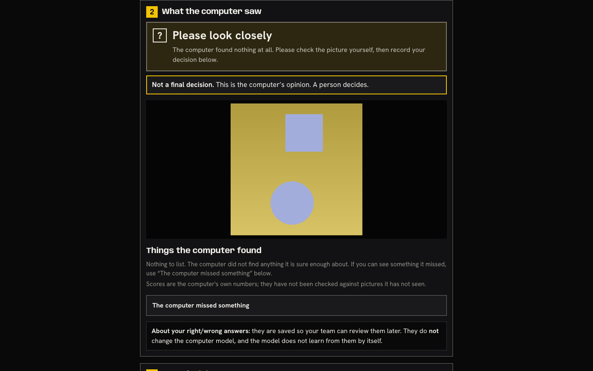
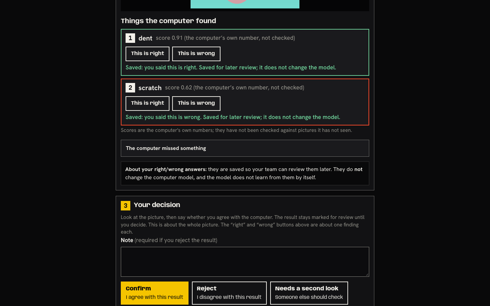
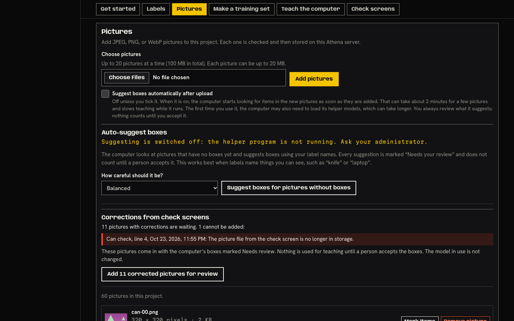
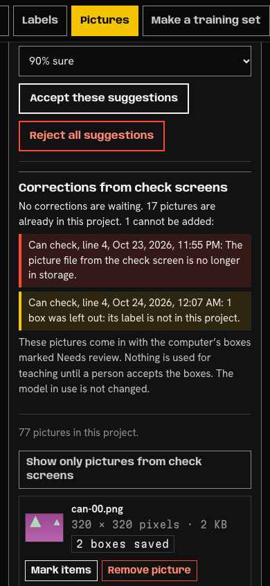
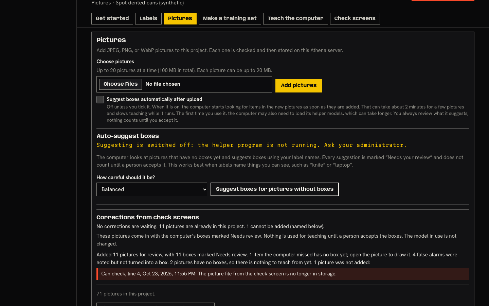
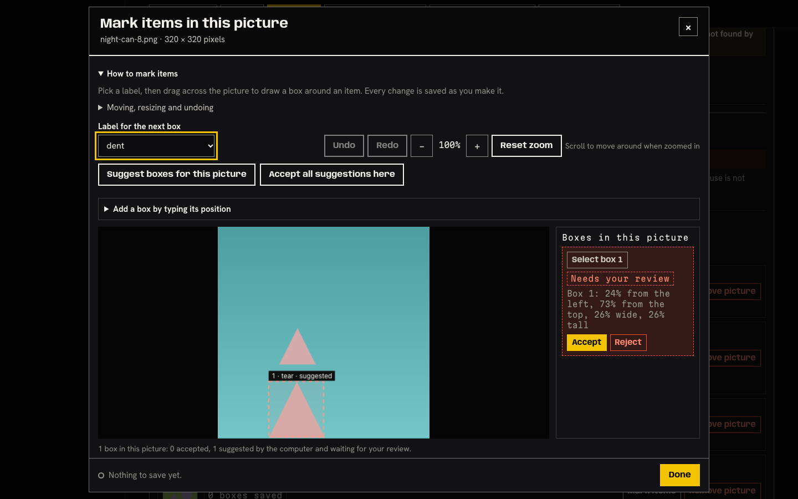
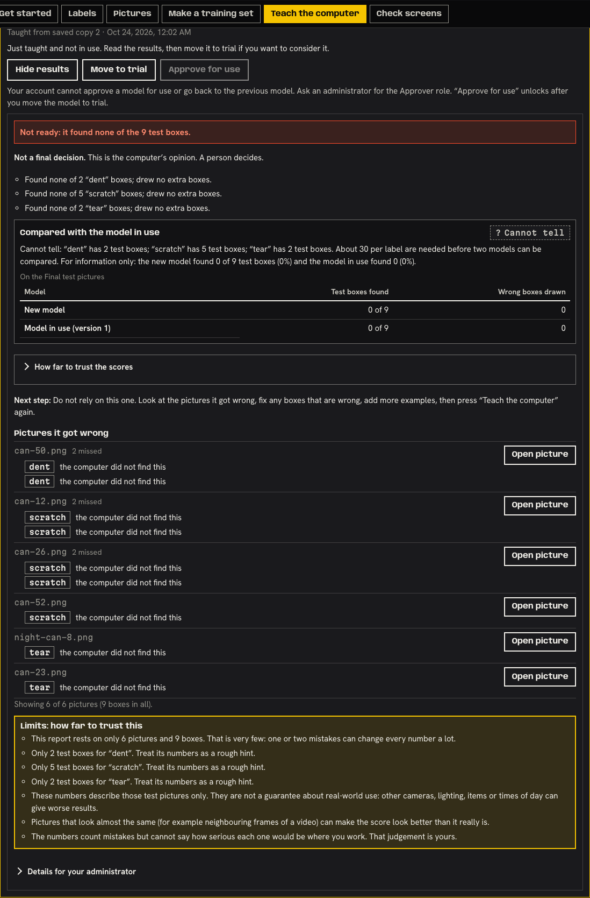
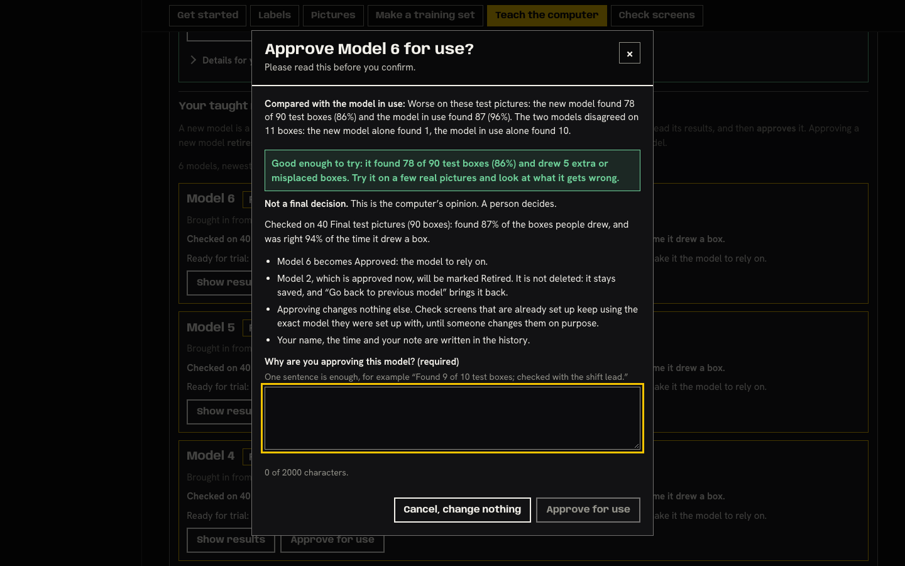
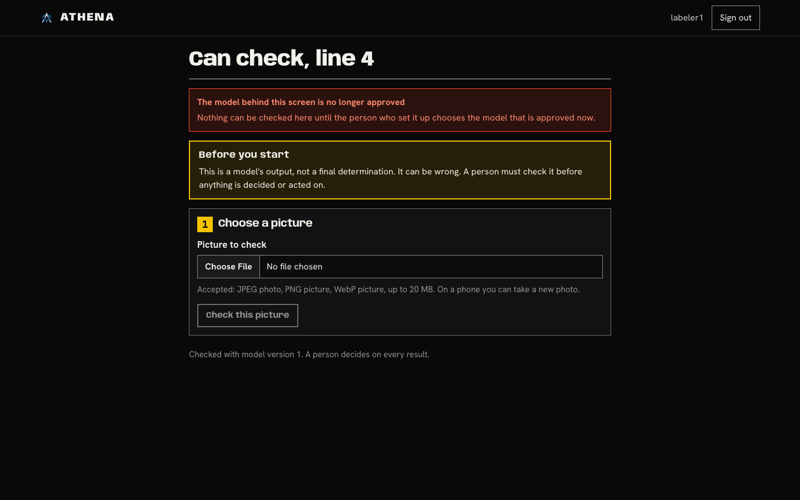

# SIMULATED USERS, LOCAL PROTOTYPE, SYNTHETIC DATA - not a usability session

**The improve loop, two persona passes: check-screen feedback (Tan) -> supervisor review, teach again, comparison, approve (Rosa).**
Not evidence for the roadmap gate that needs real operators (kit: `docs/usability/`). Two scripted personas drove disposable local instances with made-up pictures.
Date 2026-10-24 (session ran after midnight, local time). Earlier persona report and baseline: `docs/dogfood/2026-10-23-teach-flow.md`.
Target: disposable Athena console (`runserver --noreload`, DEBUG, loopback, own data folder), Chromium via Playwright 1.62.1 (headless shell 1248), 1440x900 and 390x844. Tester: Hermes subagent, read-only on product code.

## What is real and what is stubbed (read this first)

| Label | What it means |
|---|---|
| **REAL** | Seeded project "Dented cans" (60 synthetic pictures, snapshot 1, no model). Model 1 and Model 2 were taught through the administrator fold's "Teach with exactly these settings" (start from nothing, 2 rounds, batch 4) by a real `train_worker` on CPU (42 s and about 1 minute). Both were moved to trial and approved with the weak-results tick through the real dialogs. Check screen built through the real builder. Uploads by "Tan" went through the real `inference_worker` and the real Model 1. **The model finds nothing** (0 of 19 and 0 of 9 test boxes, no box at any score), as expected. Tan's "missed" boxes, Rosa's import, review, snapshot 2, second teaching run, the real "Cannot tell" comparison, approval and the check screen switch are all real code paths on that data. |
| **STUBBED detections** | A real model that finds nothing gives Tan nothing to mark wrong. For every screenshot or number marked STUBBED, the inference worker was replaced by `w11f/fake_infer_worker.py`: the real worker loop and `process_observation`, but a stand-in backend that returns two FIXED boxes (dent 0.91, scratch 0.62) for every picture. Right/wrong verdicts and missed boxes on those pictures were real clicks on real stored results; the boxes themselves are not model output. |
| **FABRICATED** | Models 3, 4, 5, 6 were written into the database with INVENTED evaluation numbers and comparison blocks ("better", "worse", "cannot tell - unfair", "worse but Good enough to try"), the same technique as the earlier L3 pass, so the real reader (`training/comparison.py`) derives the verdict and wording. Only used to read the wording of a "better" or "worse" answer and the approve dialog. Never presented as model output. Screenshot names carry FABRICATED. |
| **STUBBED one-click** | One read-only look at the Teach part on a second server over the same data, started with the cached-weights test double (`final_settings`), so the ready-made start REPORTS as usable. No weights, nothing run, nothing clicked. |

Roles used: `labeler1` (Tan, Labeler), `trainer1` / `rosa` (Rosa; `rosa` has the Approver role because Trainer cannot approve), `labeler2` (second labeler), `viewer1`/`operator1` (Viewer), `qa` (administrator, taught the models). Sessions were real logins with a throw-away password that was never printed.

## Executive summary

| Severity | Count | Tickets |
|---|---|---|
| High (RED) | 7 | T1-T7 |
| Medium (RED, wording) | 1 | T8 |
| Low catch-all (YELLOW) | 1 | T9 |
| Feature ideas (GREEN) | 1 | T10 |

**Overall:** the loop works end to end on real code: Tan's feedback arrives, Rosa's import is idempotent and exact (11 pictures, 11 boxes, 4 false alarms, 2 box-less pictures, 1 lost file, all counts verified against what was clicked), the bulk accept warns with the safe answer first, the comparison honestly says "Cannot tell", and every adversarial move that touches the server held (double click, two tabs, 0 pending, viewer, forged POST, deleted file, label renamed). The Teach part has not regressed against the earlier baseline.
What fails is **people finding and trusting each step**: Rosa cannot see that corrections exist until she opens "Pictures" (T1); Tan's natural "Reject" button never reaches her (T2); approving the new model silently takes the night-shift screen offline (T3); boxes the night shift drew are captioned as the computer's (T4); bulk accept skips exactly those boxes without saying so (T5); the "wrong" answers can never teach anything and neither end says so (T6); a worse model can be approved with one sentence (T7).

## Tan's rant (in character; floor operator, 33, night shift, canning plant)

> **Tan's review of "Can check, line 4"**
> Overall: I will use it for the pictures. I will not use it to "teach" anything, because nobody told me it does anything.
>
> **THE GOOD (grudging):** One page. Pick the picture, big button, it checks. It says "found nothing at all, please look closely" and does not pretend. The "this is wrong" box asks me for a reason and gives me an example, "that is a shadow, not damage". I can drag a box with my thumb. The green line right under the button, "Saved", is where I am looking.
>
> **THE BAD:** Every green line says the same thing: "Saved for later review; it does not change the model." Later review by who? Does it change anything? Everything I read says it does NOT do something. There is a grey box at the bottom, "About your right/wrong answers... the model does not learn from them by itself". Great. So why am I typing a reason at three in the morning? Nobody says "your supervisor uses these to make the computer better".
> I also hit "Reject, I disagree with this result". That is the one that says what I mean. Did that go anywhere? It says "You rejected this result". Nobody told me it goes nowhere.
> "Note (required)" for a dent it did not find. It found nothing. I drew the box. I still have to write a sentence.
> Twelve things to press to say "that one is wrong, and you missed a dent here". The part with the picture scrolls out of sight after I save the missed box, and I never see my box on the picture again.
>
> **THE UGLY:** Next morning the screen just says "The model behind this screen is no longer approved... until the person who set it up chooses the model". Who? There is no name, no phone number. My line is stopped.
>
> **VERDICT:** "I will click it. Nobody ever tells me it mattered."

## Rosa's rant (in character; quality supervisor, 57, WhatsApp and Excel)

> **Rosa's review of "make the computer better from what the night shift marked"**
> Overall: Not without somebody showing me where it is. Maybe after the second time.
>
> **THE GOOD (grudging):** Once I found it, the card is short and plain: "11 pictures with corrections are waiting", one button, "Add 11 corrected pictures for review". It tells me exactly what happened: 11 boxes, 4 false alarms, 2 pictures with no boxes, 1 picture lost, and it names the lost one. The warning before "accept all" puts "Check them first" first. The results card says "Not a final decision" and does not call a model that found nothing good. And it says "Cannot tell" when it cannot tell. That is honest, and I decide.
>
> **THE BAD:** "Get started" says "7 of 7 steps done. Every step is done." while eleven corrections sit waiting. Six chips along the top: Get started, Labels, Pictures, Make a training set, Teach the computer, Check screens. Where is the night shift's work? Inside "Pictures", under the upload form and the auto-suggest box. Why would a supervisor look for the night shift's work under "Pictures"? On the phone it is a screen and a half down.
> I open a night-shift picture to review it. The box the operator DREW is labelled "suggested by the computer". It was not. The operator drew it. And "accept these suggestions" accepts three boxes and leaves four, no word why. It said nothing; the sentence it wrote was gone before I could read it.
> The four false alarms, the whole point of "this is wrong": "noted but not turned into a box", "nothing to teach from yet... or leave it". So the computer will never learn from them? Nobody says.
> Then I approve. The box says the check screens "keep using the exact model they were set up with". They stopped. A grey line far above says "were not changed".
>
> **THE UGLY:** I can approve a model that is worse than the one in use by writing one sentence. The card above it has a green "Good enough to try" and a red "Worse" side by side.
>
> **VERDICT:** "It tells the truth when I find it. I should not have to know where to look."

## The pragmatism filter (step 4, out of character)

| # | Complaint | Class | Why |
|---|---|---|---|
| 1 | Corrections only exist inside "Pictures"; no chip, no count, Get started says all done, Check screens and Teach silent; phone: 1.6 screens down | **RED** | Any user hits it (the card is 0.8 screen below the panel top at 1440, 1.6 at 390). A step that exists but cannot be found is a missing step. -> T1 |
| 2 | "Reject" (whole picture) never becomes a correction | **RED** | Measured: waiting corrections 1 -> 1 after a Reject with a note. The button's own help says "I disagree with this result". -> T2 |
| 3 | Approval takes the check screen offline; dialog says "keep using"; notice says "not changed" | **RED** | Night shift blocked until someone edits the screen; the supervisor is told the opposite. -> T3 |
| 4 | Operator-drawn box captioned "suggested by the computer" | **RED** | Wrong truth source on a trust screen (`console.js:839`, `:923`). -> T4 |
| 5 | Bulk accept skips the operator-drawn boxes, no word, result sentence erased | **RED** | 3 accepted, 4 left; message overwritten in the same tick. -> T5 |
| 6 | False alarms can never teach anything and neither end says so | **RED** | "Wrong" is half of what Tan is asked to press. -> T6 |
| 7 | Worse model approvable with one sentence; green "Good enough to try" above red "Worse" | **RED** | A tick is required for "found nothing" and for thin results, not for "worse than what you use now". -> T7 |
| 8 | Messages to Tan only say what does NOT happen | **RED (wording)** | Half the answer to "does telling matter". Existing text is accurate but demotivating. -> T8 |
| 9 | Second tab / lost-file / renamed-label messages are vague; permanent "1 cannot be added"; filter button looks the same pressed; 2nd sentence of bulk dialog; same number four times on the card; buttons above the verdict | YELLOW | Real, smaller, or only some users. -> T9 |
| 10 | "Note (required)" for a missed box when nothing was found | YELLOW | The builder default (`required_note_on_override`) applies; in T9. |
| 11 | "Why is the computer so bad, it found nothing?" (Rosa) | WHITE | Tiny from-scratch model, 2 rounds, synthetic pictures. The card says so ("Not ready", "Do not rely on this one"). |
| 12 | "I do not want to tick anything to approve" (Rosa) | WHITE | The tick is the guard; T7 is about adding one, not removing. |
| 13 | "Can the screen tell me by SMS when a correction arrives?" | GREEN | -> T10 |
| 14 | "Just show me a number: better or not" | GREEN (partly done) | The comparison block does this; see check (f). |

## Measured numbers

### Tan (check screen). Task: upload -> mark wrong (+ reason) -> add missed box -> done

| Run | Actions | Screens | Notes |
|---|---|---|---|
| REAL model, nothing found, 1440 and 390 | **8**: open address, choose file, Check, open "The computer missed something", Draw, drag box, type note (required), Save | 1 page; result view 1899 px (2.1 screens) at 1440, 2389 px (2.8) at 390 (STUBBED boxes: 2072 px / 2644 px) | the "Check this picture" button sits at y=453 / 529, inside the first screen; drawing layer 290-610 px of 900 (262-582 of 844), in view |
| STUBBED detections, 1440 and 390 | **12** (11 without "This is right"): + right (1), wrong (1), reason (1), Save wrong (1) | same page | + 1 for Confirm/Reject on the whole picture, which the page says is still needed ("stays marked for review until you decide") |
| Feedback line distance | "Saved..." appears 8 px under the button pressed; the page-level note ("About your right/wrong answers") is 1150 px away (1306-1376 doc y; 1480 after findings) | | after the missed box is saved the note moves to y=1938 (below the 900 px screen) |
| Console / page errors / failed requests | 0 / 0 / 0 on every Tan run | | |

### Rosa (project page). Task: open project -> find corrections -> add -> review (accept) -> teach again -> read result and comparison -> approve or not

Actions as executed (1440, `rosa`/`trainer1`): project row (1), Pictures chip (2), **Add 11 corrected pictures** (3), "Show only pictures from check screens" (4), review 7 pictures (open, Accept, Done = 21) + bulk accept (2) = 23, Make a training set chip (1), Save a snapshot (1), Teach chip (1), open administrator fold (1), rounds and batch (2 typed), Teach with exactly these settings (1), Show results (1), Move to trial (2), Approve (1) + reason + tick + confirm (3), Check screens chip, Edit, Save (3) = **44 actions on 7 parts**. By hand only (9 boxed pictures), review is 27 instead of 23. The one-click "Teach the computer" button (T1 of the earlier pass) is switched off in this environment, so "teach again" went through the administrator fold. "Teach again" is therefore not something Rosa can do alone here.

| Measure | 1440x900 | 390x844 |
|---|---|---|
| Corrections count visible without opening a part | **no** (hidden in the Pictures part; project start screen height 1686 px, mentions "check screens" only as a chip and a checklist row that says all done) | **no** (3034 px) |
| Corrections card top vs the Pictures panel top | 710 px below it (0.8 screen, in the first screen after the click) | 1373 px below it (1.6 screens) |
| Corrections card | 90 words, 217 px high, 0 jargon hits | 350 px high |
| Import result sentence (11 added) | 76 words, 0 jargon | same |
| Pictures part height with 77 pictures | 9937 px document (11 screens) | 15366 px (18 screens) |
| Yellow (primary) buttons per part | Pictures 1 ("Add pictures"), Teach 1, Check screens 1, Get started 1, Make a training set **3** (Save a snapshot + two "Download for training"). The corrections buttons are secondary (white), not yellow | same |
| Results card (Model 2, real) | 492 words closed, 974 with drawers open; card 1667 px high; jargon closed: `candidate` x1; open: `snapshot`, `candidate`, `IoU` | 470 / 964 words; 2904 px; same jargon |
| Approve dialog | 238 words; 0 jargon. Trial dialog 108 words, `candidate` x1 | |
| Jargon list (snapshot, epoch, batch, observation, artifact, SHA, candidate, validation, pretrained, backbone, IoU, AP50, asset) on the feedback rows, corrections card, import result, bulk dialog, approve dialog | **0** | **0** |
| Page overflow sideways | none | none |
| Console errors | 0 (the only error on any run is the deliberate 403 of the viewer's forged POST) | |

### Teach part against the earlier baseline (`baseline.json`, `after-default.json`), same script, fresh seeded and cold instances

| Measure | Baseline | Earlier pass | Now |
|---|---|---|---|
| Seeded, 1440: document / Teach panel / button y | 3060 / 2032 / 1387 px (1.54 screens) | 2598 / 1570 / 923 (1.03) | **2590 / 1562 / 904 (1.00)** |
| Seeded, 390 | 5137 / 3382 / 2216 (2.63) | 4200 / 2445 / 1475 (1.75) | **4134 / 2379 / 1400 (1.66)** |
| Cold, 1440 / 390 button | 1403 (1.56) / 2203 (2.61) | 902 (1.00) / 1365 (1.62) | **884 (0.98) / 1333 (1.58)** |
| Jargon on first view (11-term list), every case | 13 / 11 | 2 | **2** (both `candidate`) |
| Jargon, drawers open (seeded) | 38 | 30 | **30** |
| Visible words, seeded | 571 | 460 | **402** |
| Fields before the button / drawers | 2 / 4 | 0 / 1 | **0 / 1** |
| Primary buttons in the Teach part | 2 | 1 | **1** |
| Errors | 0 | 0 | 0 |

**No regression** (equal or smaller in every row). Raw: `athena-qa/w11f/after-default-w11f.json`.

## The checks you asked for

### (a) Can Tan tell what his feedback does?

- **Text that exists:** after each answer, "Saved: you said this is wrong. Saved for later review; it does not change the model." (8 px under the button). At the bottom of the result card: "About your right/wrong answers: they are saved so your team can review them later. They do not change the computer model, and the model does not learn from them by itself." Both are accurate.
- **Text that is missing:** nothing says that a supervisor can turn these answers into teaching material, who that is, or that "wrong" answers cannot be used for teaching at all (T6). Every sentence says what does NOT happen. The suggested sentence ("The supervisor can use this to improve the computer; nothing changes by itself") does not appear anywhere. -> T8.
- **Reject:** the whole-picture "Reject - I disagree with this result" is the button Tan will press. It never reaches the supervisor (T2).
- 
- 

### (b) Can Rosa find the corrections without being told? **No: RED (T1).**

- Chip bar: Get started, Labels, Pictures, Make a training set, Teach the computer, Check screens. No "Corrections" chip, no badge, no count (all six chips read as plain text).
- With 11 (and later 1) corrections waiting, visible text mentioning "correction" or "from check screen": **Get started, Labels, Make a training set, Teach, Check screens: 0 hits. Pictures: 3.** "Get started" read "7 of 7 steps done. Every step is done." Only after importing does it say "Review the boxes - Do this next".
- 
- On the phone: card top 1373 px under the panel top 

### (c) Wording: "Corrections from check screens", the badge, "Needs review", "Add N corrected pictures for review"

- Card heading and button are plain; **0 jargon hits** on the card, the result, the feedback rows ("From a check screen", "0 boxes saved", "1 to review", "Review suggestions") and the bulk dialog.
- Count line: "11 pictures with corrections are waiting. 1 cannot be added:" reads as "1 of the 11"; it is 11 addable plus 1 extra (11 were added, 12 in all). After import the line becomes "No corrections are waiting. 11 pictures are already in this project. 1 cannot be added (named below)." and the "1 cannot be added" stays for ever (T9).
- "Needs review" (boxes) and "to review" (rows) are consistent; the box tag in the editor says "Needs your review" (a third form).

### (d) The box-less "false alarm only" picture

- Row text: "Nothing to teach from yet: draw a box if something should be found, or leave it." Import result: "4 false alarms were noted but not turned into a box. 2 pictures have no boxes, so there is nothing to teach from yet."
- Not clear what to do: "draw a box" does not fit a FALSE alarm (there is nothing to draw), and "leave it" means the picture is dropped: snapshot 2 said "2 pictures have no accepted boxes, so they are left out". The wrong answers the night shift typed reasons for are never used. -> T6.

### (e) Bulk accept and the filter

- Bulk dialog "Some of these boxes come from check screens" - "Check them first" (default, yellow) / "Accept anyway". Safe answer first: **pass.** Second sentence ("the ones that meet the 'at least this sure' level you chose are accepted along with the rest") is confusing.
- Real behaviour: with "Any suggestion" and "Accept anyway", **3 of 7 boxes were accepted; the 4 drawn by operators (no score) stayed "suggested"** (read back from the database: the four `confidence=None` boxes). The result sentence "Accepted 3 suggested boxes. 4 boxes still need your review." is written and then overwritten in the same tick by "Loading pictures..." and "71 pictures in this project." (MutationObserver saw only those two). -> T5.
- Filter "Show only pictures from check screens": works (71 rows, 11 visible), status line "71 pictures in this project. Showing only the 11 from check screens." The button label does not change when pressed (only aria-pressed and a lighter fill).
-  (after-import card; the bulk dialog screenshot is in the scratch folder only: `w11f/shots/r5-desktop-bulk-accept-dialog.png`)
- Editor caption: a box drawn by Tan shows "1 · tear · suggested", "1 box in this picture: 0 accepted, 1 suggested by the computer and waiting for your review", and after accepting "Suggested by computer, accepted by you". Wrong source (T4). 

### (f) The results card

- **Order of trust: pass.** Verdict (measured) -> per-label lines -> "Compared with the model in use" -> table -> "How far to trust the scores" -> next step -> pictures it got wrong -> Limits; "Details for your administrator" last. Nothing the file claims about itself comes before what was measured.
- **Her question "is it better?"** Real answer: "? Cannot tell - 'dent' has 2 test boxes; 'scratch' has 5 test boxes; 'tear' has 2 test boxes. About 30 per label are needed before two models can be compared. For information only: the new model found 0 of 9 test boxes (0%) and the model in use found 0 (0%)." Honest and in plain words; the answer sits 200 px under the headline at 1440 and on the first phone screen after "Show results".
- FABRICATED wording: "Better on these test pictures: the new model found 70 of 90 test boxes (77%) and the model in use found 55 (61%)... the new model alone found 17, the model in use alone found 2"; "Worse on these test pictures..."; unfair: "Cannot tell, and this comparison is not fair: 6 of the 40 test pictures were also used to teach or check the model in use". All clear.
- **Duplicates:** in the real card "0 of 9" is said four times (headline, per-label lines, comparison sentence, comparison table); "How far to trust the scores" and Limits both say the numbers are thin. Not contradictory, noisy. **Contradiction (FABRICATED, Model 6):** green "Good enough to try: it found 78 of 90..." directly above the comparison "! Worse" - Rosa gets "good" and "worse" in one card (T7). 
- **Not a final decision:** present on the card and in both dialogs. **Pass.**
- Buttons (Hide results / Move to trial / Approve for use) still sit ABOVE the verdict (y=1712 vs headline y=1826), as in the earlier pass.
- **Could she approve a worse model by accident?** Real Model 2 ("found nothing", Cannot tell): reason + tick required. FABRICATED Model 4 (Not ready + Worse): reason + tick. **FABRICATED Model 6 (Worse, but verdict "Good enough to try"): only a typed reason; no tick.** The dialog does lead with the "Worse" sentence, and Cancel is a normal button, but the focus is in the reason box. (T7) 

### (g) After approval, does the night shift learn a new version is live?

- The check screen shows the model version only as the last line, 15 px grey: "Checked with model version N. A person decides on every result." (y=1995 of a 2072 px page).
- Nothing says "new version". What actually happens: approving Model 2 **retired Model 1, and the check screen (set up on Model 1) was blocked at once**: Tan sees "The model behind this screen is no longer approved. Nothing can be checked here until the person who set it up chooses the model that is approved now." Check button and file box disabled. No name, no contact. 
- Rosa's side: the approve dialog says "Check screens that are already set up keep using the exact model they were set up with, until someone changes them on purpose." The screen does not keep using it, it stops. After approving, a small status line above the model list says "Model N is now Approved. These check screens still use the retired model and were not changed: Can check, line 4." The old model's card says "Retired... not in use" and "Used by: Can check, line 4". The Check screens part says "! Not working... Uses Model 1 (not in use)... Open 'Edit' to choose a model that is." (good, but she only sees it if she goes there). Fix path is short: Check screens -> Edit -> the dropdown already offers only the approved model, pre-selected -> Save = 3 actions. -> T3.

### (h) Adversarial moves

| Move | Result |
|---|---|
| Double-click "Add corrected pictures" | Server idempotent: no duplicate pictures (read back); the second POST answered `already_imported` for each |
| Two tabs (Rosa and `labeler2`, 4 waiting, pressed at the same moment) | One tab won (4 pictures added). The other tab said "No new pictures were added. 5 pictures were not added: Can check, line 4, 12:06 AM: This result was already pulled into the project." x4 plus the lost file. Safe, but the loser reads "not added" about pictures that are in the project, and the four lines are identical (no picture name). T9 |
| Press with 0 pending | The button is hidden. A forged POST answered 200 `{imported: [], skipped: [the lost file again], remaining_pending: 0}` - harmless |
| Import then refresh | Back on the project's start part (not Pictures); the card says "No corrections are waiting. 15 pictures are already in this project"; the result sentence (what was added, what is left) is gone |
| Back button mid-flow | Part chips add no history; Back stays on `/#project=...` (as in the earlier pass) |
| Label renamed after feedback (`scratch` -> `scrape`, then import) | "1 box was left out: its label is not in this project." Does not name the label or the picture (`Can check, line 4, 12:07 AM`) |
| Deleted picture (file removed from storage) | "1 picture was not added: Can check, line 4, 11:55 PM: The picture file from the check screen is no longer in storage." Named by screen and time only; stays in the count line for ever |
| Viewer (`viewer1`) | Card visible, button disabled with "Your account can look but not change things. Ask an administrator for the Labeler role."; forged POST 403 with the same sentence. Viewer on Tan's screen: Check button and file box disabled with the same sentence. **Pass** |
| Phone width, both personas | Tan: 8 / 12 actions, drawing layer in view, 0 console errors (sideways scroll not measured on the check screen); Rosa: card readable (screenshot above), no sideways scroll; results card 2904 px tall but the verdict and comparison are on the first screen after "Show results" |
| Trainer (not Approver) | Under the buttons: "Your account cannot approve a model for use or go back to the previous model. Ask an administrator for the Approver role." Clear. A quality supervisor needs the Approver role to do her last step |

### (i) Jargon and verbosity

Numbers are in the tables above. Yellow buttons per part: one in each part except "Make a training set" (three, not part of this loop). The corrections card is short (90 words); the results card is 492 words closed, 974 open.

## Issues (ticket-ready, ranked; labels: `ux-review`)

### T1 (High, RED): Rosa cannot find the corrections
Where: `web/projects/templates/projects/console.html` `#jump-nav` (lines 75-80) and `#corrections-panel` (inside `#image-assets-panel`, below the upload form and auto-suggest); `console.js` `renderCorrections` (line 524) and `checklistSteps` (line 5357). Quote: "Why would a supervisor look for the night shift's work under 'Pictures'?"
Fix: show the waiting count where she looks first: a count on the Pictures chip ("Pictures - 4 corrections"), a checklist row "Review corrections from the check screens (4 waiting)" that opens the card (today the checklist says "Every step is done"), and put the card at the top of Pictures when N > 0. At 390 the card is 1373 px under the panel top.

### T2 (High, RED): Tan's "Reject" never becomes a correction
Where: `checkscreen_core.js:23` (`Reject` / "I disagree with this result"), `checkscreen.js:420` `onDecide`, `feedback_import.py` (reads only `FeedbackRecord`; whole-picture decisions are never read). Measured: waiting 1 -> 1 after Reject + note. Quote: "That is the one that says what I mean."
Fix: either pull rejected pictures in as "picture marked wrong, no box", or say it on the button ("The supervisor will not see this as a correction; mark each wrong finding too") and offer "This is wrong" first.

### T3 (High, RED): approving a model takes the live check screen offline, and the dialog says the opposite
Where: `console.js:4962` (dialog line "keep using the exact model they were set up with"), the status line `#tr-models-status` ("These check screens still use the retired model and were not changed"), `training_views.py:334`, `lifecycle.py:690` (approval retires the previous model), `checkscreen.js:69` (the blocker, names nobody). Quote: "They stopped."
Fix: in the dialog say "Check screens that use Model 1 (Can check, line 4) will STOP until you switch them", with a tick "Switch these screens to Model 2 as well"; after approval a visible banner with a "Switch now" button, not a grey line above the list; the blocker on the night shift's screen names the person or says who to ask.

### T4 (High, RED): operator-drawn boxes are captioned as the computer's
Where: `console.js:839` ("suggested by the computer and waiting for your review"), `:923` ("Suggested by computer, accepted by you"; the box's `model_name` is "operator feedback"). Quote: "The operator drew it. It was not the computer."
Fix: caption by origin: "Drawn by the night shift, waiting for your review" / "Confirmed by the night shift (the computer's box)"; the percent "91% sure" only on boxes that have one.

### T5 (High, RED): bulk accept silently skips the boxes people drew; its result is erased
Where: `console.js:1825-1850` (`assetStatus.textContent = "Accepted N..."` and then `loadAssets` overwrites it in the same tick), `feedbackBoxesWarning`. Measured: 3 of 7 accepted, 4 (`confidence=None`) left. Quote: "It said nothing."
Fix: keep the result line after the reload ("Accepted 3. 4 boxes drawn by people are not accepted by this button; open them one by one"); say it in the dialog; offer "Accept all night-shift boxes after I looked" as one explicit step.

### T6 (High, RED): "wrong" answers can never teach anything, and neither end says so
Where: `console.js:469` (`CORRECTIONS_NOTHING`), the import sentence ("4 false alarms were noted but not turned into a box"), dataset rule ("pictures with no accepted boxes are left out"), `checkscreen.js:279-280` (Tan's "Saved for later review"). Quote: "So the computer will never learn from them? Nobody says."
Fix: tell the truth at both ends ("Wrong answers are kept as a record. The computer cannot learn from them yet.") or support picture-without-boxes examples in snapshots; do not offer "draw a box" for a false alarm.

### T7 (High, RED): a worse model can be approved with one sentence
Where: `console.js:4504-4506` and `:5105` (`TR_WEAK_ACK` is tied to the verdict only), the card headline. FABRICATED Model 6: green "Good enough to try" above "! Worse", approve needs only a reason. Quote: "I can approve a worse model by writing one sentence."
Fix: require a tick when the comparison verdict is "worse" ("I understand it found fewer boxes than the model in use"), enforce it on the server like the weak-results tick, and show the comparison before (or instead of) a green headline. Also move Move/Approve below the verdict (carry-over of T5 from the earlier pass).

### T8 (Medium, RED wording): Tan is only told what does not happen
Where: `checkscreen.js:279-280` and `:416` (the "Saved for later review" lines), `checkscreen.html:103` (`#cs-feedback-note`). Fix: "Your supervisor can use your answers to improve the computer. Nothing changes by itself." Also: "Note (required)" on a missed box when nothing was found (builder default `required_note_on_override`); keep the picture and the drawn box visible after saving.

### T9 (Low, YELLOW catch-all)
- Lost-file / second-tab / label-renamed lines name only the screen and a time, not the picture or the label; the loser of two tabs reads "not added" for pictures that are in.
- "1 cannot be added" stays in the count line for ever and cannot be dismissed.
- Count line "11 ... are waiting. 1 cannot be added" reads as 1 of the 11.
- Filter button label does not change when pressed.
- Bulk dialog second sentence; review panel still shows "Accept these suggestions" at 0 waiting.
- Results card repeats "0 of 9" four times; buttons above the verdict.
- Blocked check screen names nobody.
- "Make a training set" has three yellow buttons.

### T10 (GREEN): ideas from the complaints
A count on the Pictures chip and a "N waiting" note on the project row; one "Switch screens to the new model" button next to Approve; a short thank-you line on the check screen ("Your 3 answers from last night went into the new version"); a "say what you saw" quick list for "wrong" reasons.

## Summary table

| # | Title | Severity | Class | Where |
|---|---|---|---|---|
| T1 | Corrections cannot be found | High | RED | `console.html` `#jump-nav`, `#corrections-panel`; `console.js` `checklistSteps` |
| T2 | "Reject" never becomes a correction | High | RED | `checkscreen_core.js:23`, `checkscreen.js:420`; `feedback_import.py` |
| T3 | Approval takes the check screen offline; dialog says "keep using" | High | RED | `console.js:4962`, `training_views.py:334`, `checkscreen.js:69` |
| T4 | Operator boxes captioned as the computer's | High | RED | `console.js:839`, `:923` |
| T5 | Bulk accept skips operator boxes; message erased | High | RED | `console.js:1825-1850` |
| T6 | "Wrong" answers cannot teach; nobody says | High | RED | `console.js:469`; dataset rule; `checkscreen.js:279-280` |
| T7 | Worse model approvable with one sentence | High | RED | `console.js:4504-4506`, `:5105` |
| T8 | Tan only told what does not happen | Medium | RED wording | `checkscreen.js:279-280`, `checkscreen.html:103` |
| T9 | Catch-all | Low | YELLOW | various |
| T10 | Ideas | n/a | GREEN | n/a |

## Not tested

- Real operators and real supervisors, any usability metric (no SUS, no timing by people); this is a simulation.
- Firefox, Safari/WebKit proper (Chromium only), any screen reader (only focus and DOM read).
- Real weights (everything was taught from nothing, 2 rounds), real scanner or can images (made-up shapes), **a model that is actually good**: no real "Good enough" or "Better" verdict was seen, only FABRICATED ones; the real "Cannot tell" depends on 9 test boxes.
- A real running one-click start (STUBBED look only: ready-made start usable, licence tick, "Quick about 4 minutes"); the Teach part was not asked for corrections waiting or boxes still needing review.
- Real detections for Tan's "wrong" answers: the screenshots and counts that include a "This is wrong" are STUBBED detections (fixed boxes).
- Refresh during a running teaching job or running check (tasks ran to completion between steps); more than 100 waiting pictures (`LIST_LIMIT`), more than 50 at once (`IMPORT_BATCH_LIMIT`); EXIF-rotated pictures, giant pictures; two real people at two computers.
- Axe, keyboard-only walk of the new parts (Tab order of the corrections card and dialogs was not exercised in this pass).

## Notes

- Disposables: main instance on 127.0.0.1:18861 (own data folder, real `train_worker`, `inference_worker`, later the stand-in worker), a second server on 18862 over the same data with the test double for one read-only screenshot, two fresh baseline instances on random ports for the Teach regression. All stopped at the end. Servers on ports 18772 and 59878 belong to other work and were not touched. Nothing in the repo was changed except this report and nine screenshots.
- Harness (scratch): `athena-qa/w11f/` (`run.sh`, `tan.mjs`, `tan2.mjs`, `r1..r21*.mjs`, `fake_infer_worker.py`, `seed_fab_cmp*.py`, `out/*.json` raw numbers, `shots/` all screenshots). Screenshots with STUBBED or FABRICATED in the file name are labelled in this report as well.
- Recommend confirming T1, T2, T3 and T6 with two or three real night-shift operators and one supervisor before treating the fixes as settled.
