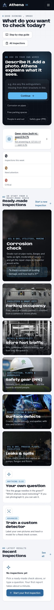
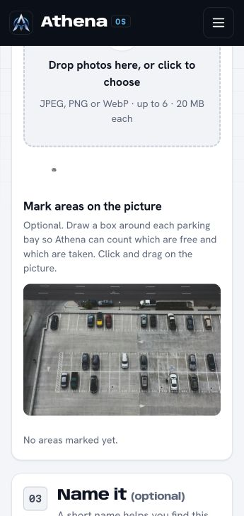
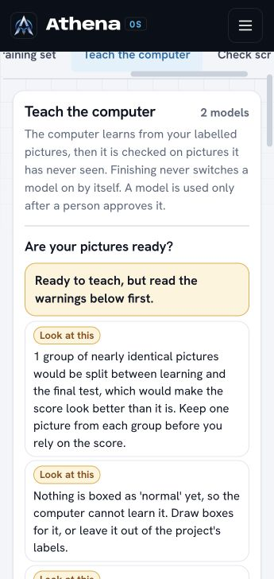
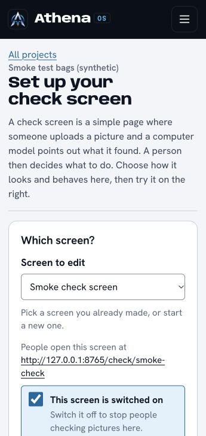

# Athena OS computer vision workflow and full build plan

Date: 15 November 2026. Status: proposed full build plan; implementation checkpoint and current test evidence are recorded in the [task list](2026-11-15-vision-workflows-task-list.md). Baseline: local `main`, commit `a5a44ba`, with a clean working tree before this review. Audience: product owner, design, engineering, QA, and pilot operators.

Athena should let a person describe an operational outcome, mark the relevant places in a camera view, check the result against reality, and publish a useful screen. People counting, parking occupancy, custom inspections, and model training should share this lifecycle. The first release should prove people counting and parking occupancy end to end before expanding the catalogue.

The current build is a useful foundation for assisted image inspections and reviewed image-detection training. It is **not yet demonstrated ready for dependable live entry/exit counting or parking monitoring**. This conclusion concerns the workflow requested here; it does not mean the existing image tools have no value.

Companion: [implementation task list](2026-11-15-vision-workflows-task-list.md). Current T05 design and implementation boundary: [operation draft/release bundle contract](2026-11-16-operation-draft-release-bundles.md). Existing [roadmap](../../ROADMAP.md) remains the historical milestone record; this proposal does not mark its items complete.

## Executive read

Athena already makes a useful first step: people can ask a question about pictures without writing code. Its latest home screen includes parking and footfall templates, while a separate workspace supports image labels, dataset snapshots, teaching, approved models, and configurable check screens. The missing layer is a durable operation that connects a source, understands movement over time, applies explicit business rules, and keeps an auditable result. Roboflow already supports tracking and line-counting workflows, so Athena's proposed advantage is simpler setup, guided testing, and daily operation for people without computer vision expertise. Training should be an improvement path within an operation, with a suitable starting model offered first. Release readiness must be measured on real camera conditions and real operator tasks, rather than inferred from a working image report or a high detector score.

## Scope and evidence

The review covers today's local source and a current browser walkthrough of Home, parking setup, Teach the computer, and the check-screen builder. The research horizon is the current product landscape, checked on 15 November 2026; the delivery horizon below is an ordered build sequence without committed release dates.

The browser instance used an isolated scratch database, generated example images, and clearly identified stand-in models. Its vision endpoint was deliberately unavailable so no pictures were sent to an external AI service. Training was unavailable in that lean preview; this is evidence about installation dependency handling, not proof that training fails in every deployment. No real operator, camera, training run, or accuracy benchmark was exercised. The focused current home/marked-region test modules passed: **18 tests**, with no skipped tests. These checks do not validate the proposed live workflows.

### Current capabilities and gaps

| Area | Observed in the current build | Implication for this proposal |
|---|---|---|
| Entry point | Home offers questions and ready-made image inspections; custom detector training is a separate advanced path. | Reuse the outcome templates, but connect each to a persistent operation and an optional learning path. |
| Photo and video inspection | The browser extracts six evenly spaced still frames from a video. The server stores pictures and optional frame times. | This is sampled-image interpretation, not a continuous tracking pipeline. Crossings between frames can be missed. |
| Parking marks | Users can draw up to 24 axis-aligned rectangles on the first image. Coordinates and names become instructions to a vision-language model. | A helpful one-off inspection aid; it does not supply persistent bay geometry, per-bay state, or calibrated occupancy rules. |
| Footfall | A template asks a vision model about people walking in/out. | Facing direction or sparse frames cannot establish complete crossing events. A line editor and tracking history are required. |
| Dataset and training | Reviewed boxes, immutable versions, exports, training workers, model stages, and approval paths exist. | Preserve these foundations and measure real-world model quality before claiming readiness. |
| Segmentation | SAM assists box suggestions; annotation/training contracts in this console are box oriented. | SAM use does not establish a complete user-facing segmentation dataset/training/export workflow. |
| Custom UI | Check screens configure titles, displayed labels, thresholds, status words, decisions, and human review. | Extend the validated configuration approach to widgets and metrics; a general operational dashboard builder is additional work. |
| Review and improvement | Detector check-screen corrections can become reviewable training candidates. Inspection reports also have report feedback. | Connect operation events and report feedback to explicit, reviewed improvements; do not assume the two feedback paths already form one loop. |
| Access | Existing console/project roles; operation scope, drafts and media are owner-only, independently of role rank. | Current role/capability boundaries are in [operation access map](2026-11-16-operation-access-capability-map.md). Any future sharing requires explicit operation-scoped grants and an audit trail; keep inspections private. |
| Runtime | Image inference has a worker; vision inspections use background daemon threads. | Continuous sources need supervised workers, durable jobs, recoverable state, and camera health. |

Owning sources: [routes](../../web/projects/urls.py), [home](../../web/projects/templates/projects/home.html), [inspection browser code](../../web/projects/static/projects/inspect.js), [marked areas](../../web/projects/vision/regions.py), [vision execution](../../web/projects/vision/service.py), [persistent models](../../web/projects/models.py), [check-screen configuration](../../web/projects/inference/schema.py), and [training quality guide](../guides/model-quality.md). The README and roadmap lag parts of the new inspection flow; the table above uses the owning source rather than relying on their summaries alone.

### Captured walkthrough

| Step | Current screen and health | Finding and limit |
|---|---|---|
| 1 | Home — understandable first action; incomplete path to an ongoing operation. | Plain-language templates help discovery. A footfall question can be mistaken for a proven counting capability. |
| 2 | Parking setup — usable starting point for a photo inspection; incomplete for monitoring. | The image and instruction to mark bays are clear. A camera source, perspective polygons, and persistent bay state are absent from this flow. |
| 3 | Teach — helpful readiness explanations; blocked in this preview. | The screen explains missing teaching tools and dataset weaknesses. The next installation action belongs to an administrator, so users need a managed readiness handoff. |
| 4 | Check-screen builder — useful constrained customization; incomplete for analytics layouts. | The page explains model choice and review behavior. It accepts images and has no operating metrics, event timeline, or parking map editor. |

Screenshots below were captured in this review at the browser's existing narrow viewport. They establish visible wording and layout in that state, not desktop, screen-reader, or full accessibility compliance. Step 2 also used the application's bundled example parking image; it is not a measured pilot.

<details>
<summary>Current Home screenshot</summary>



</details>

<details>
<summary>Current parking area setup screenshot</summary>



</details>

<details>
<summary>Current Teach screenshot</summary>



</details>

<details>
<summary>Current check screen builder screenshot</summary>



</details>

## Research findings and priorities

Severity means impact on the requested outcome, not an estimated number of affected customers. Frequency signals below describe this evidence set only. Confidence separates an observed mechanism from an untested product hypothesis.

| Rank and type | User goal and surface | What breaks and evidence | Severity and frequency signal | Confidence and product move |
|---|---|---|---|---|
| 1 — missing temporal capability | Count actual arrivals/departures from video. Home and footfall inspection. | Six sampled images lack continuous track state. Roboflow's documented line-counting recipe explicitly combines detection, tracking, and crossing logic [Roboflow line-counting guide](https://roboflow.com/blog/count-objects-crossing-lines). | Critical; structurally affects every attempt to use this path for complete crossings. | High on current gap. Build an event engine and a replay test before offering live counts. |
| 2 — setup/workflow complexity | Turn detections into a business answer. Builder and reporting. | A Roboflow forum user could detect products but struggled to aggregate counts and calculations; the answer required additional blocks and deployment constraints [Roboflow forum case](https://discuss.roboflow.com/t/help-needed-counting-detected-objects-and-calculating-calories-in-roboflow-workflow/10315). | High; one concrete support thread, not prevalence evidence. | Medium on wider demand; high that this case exists. Offer task recipes with named outputs and editable rules. |
| 3 — semantics and trust | Know whether a number means current presence, crossings, or unique visitors. Dashboard. | Supervision distinguishes per-frame zone occupancy from unique entry counting [Supervision zone-counting reference](https://supervision.roboflow.com/0.28.0/how_to/count_in_zone/); Athena currently offers an in/out question without a persistent event history. | Critical for footfall interpretation; a documented distinction, not a frequency measurement. | High. Give each metric a definition, time window, source, and coverage. |
| 4 — environment suitability | Monitor parking from existing CCTV. Source setup and area editor. | One parking discussion raises obstruction and oblique camera angles [parking discussion](https://www.reddit.com/r/computervision/comments/1u7qe13/outdoor_parking_lot_occupancy_detection_how/). Athena's current template uses a favourable aerial example and rectangles. | High; one small discussion and a local UI limitation. | Medium for demand, high that hidden bays cannot be observed. Require a view-quality check and Unknown states. |
| 5 — onboarding/dependency friction | Reach a first successful test without technical setup. Training and AI connection. | The local Teach screen explains that the tool is unavailable; the quality guide documents administrator setup for starting weights. | High; observed in this isolated preview, deployment-dependent. | High on dependency, unmeasured on real-user incidence. Surface a preflight with owner and recovery action. |
| 6 — reliability and recovery | Keep work and know whether it completed. Annotation, exports, and jobs. | One Roboflow thread reports intermittent assisted-label and export problems; follow-ups say some steps later worked [user experience discussion](https://www.reddit.com/r/computervision/comments/1rt8v1h/experience_with_roboflow/). Athena inspection execution currently lives in web-process threads. | High; anecdotal external signal, direct internal mechanism. | Medium on prevalence; high on recovery need. Use durable state, visible save status, resumable work, and bounded retries. |
| 7 — UI flexibility versus operator simplicity | See a useful board without building software. Check-screen builder. | Current validated settings customize an image checker, not an operational board. | High for requested customization; direct feature gap. | High on gap, untested on preferred widgets. Start with safe preset layouts and metric bindings. |
| 8 — docs and vocabulary | Find the next useful action. Home, learning workspace, help. | Inspection and training have different entry points and lifecycle concepts; some summary docs do not yet describe the newer path. | Medium; direct inconsistency, no measured abandonment rate. | High on mismatch, medium on impact. One operation checklist, task-linked help, maintained capability labels. |

Account/billing complaints were not used to infer Athena priorities. Access/setup belongs in this build because roles, camera credentials, and deployment readiness directly affect the requested workflows. No customer-support volumes, session analytics, or interviews were available, so this is a source-grounded assessment and design proposal, not a validated demand study.

### Competitive interpretation

Roboflow is already more than a detector/segmenter: its documented workflow includes a video source, detection, tracking, line counting, and output [Roboflow line-counting guide](https://roboflow.com/blog/count-objects-crossing-lines). Frigate documents drawn zones, explicit object anchors, inertia, and loitering controls [Frigate zone reference](https://docs.frigate.video/configuration/zones/). Those products demonstrate useful capabilities; they do not establish that Athena must copy their full interface.

Athena's proposed distinction is **an outcome recipe with an explanation, an observable test, and an operator screen**. A novice should select “Count people entering this door,” not assemble tracker blocks. An expert should still be able to inspect the generated recipe and adjust supported settings. This is a product hypothesis to validate with the scenarios below.

## Proposed product structure

### Navigation and roles

| Main area | What users do there |
|---|---|
| Overview | See sites, running operations, gaps in data, and the next action. |
| Operations | Create an outcome, connect its source, mark its geometry, test, and publish. |
| Live view | Open the published operator screens permitted for the person's role. |
| Events and reports | Find the evidence behind a number, review corrections, and compare periods. |
| Data and learning | Review examples, teach or compare models, and manage dataset versions. |
| Sources | See camera health and coordinate setup with an installer. |
| Settings | Manage people, access, processing location, retention, and approved integrations. |

Keep **Inspect a photo** as a quick action. Store it as an inspection; offer “Use this setup again” to create a draft operation with explicit source and rule review. Existing inspections retain their existing access boundaries.

| Persona | Default permissions | Main interface |
|---|---|---|
| Owner/administrator | Manage workspace, processing choices, access and approved destinations. | Overview and settings. |
| Installer | Connect assigned sources and calibrate views; no automatic access to all reports. | Source checklist and connection diagnostics. |
| Builder/trainer | Configure assigned operations; label and train where permitted. | Guided setup and data/learning. |
| Approver | Approve a specific operation release and model use within assigned scope. | Test evidence and release comparison. |
| Operator | Monitor, acknowledge, and submit corrections for assigned operations. | Published screen and review queue. |
| Viewer | Read permitted reports and boards. | Live view and reports. |

Map these capabilities onto existing roles where possible. Add operation/site scope explicitly; do not create six parallel permission systems or imply the role names already exist.

### The main workflow

1. **Choose an outcome.** People in/out, parking spaces, zone presence, queue/dwell, item count, defect check, or custom supported rule. Show whether it is ready, trial-only, or unavailable.
2. **Choose the place and source.** Name the site; upload a test video, connect an approved camera, or select a photo for a one-off check. Explain where processing happens and whether footage is retained.
3. **Check the view.** Show live freshness, coverage, object size, obstruction and lighting examples. A poor view offers a recorded alternative or installer action.
4. **Mark what matters.** Draw a line, zone, or named parking bays. Label direction in everyday words. Separate operational areas from object labels used for training.
5. **Try the starting model.** Automatically select a compatible approved model. Show detections and the resulting events. If it fails, distinguish source, geometry, rule, and model problems.
6. **Improve only if needed.** Capture examples, review suggestions, teach, compare, and approve a candidate. Keep the operation setup while learning happens.
7. **Test the outcome.** Replay a representative clip against a person's reference counts/states. Show errors and uncovered conditions, not just detector accuracy.
8. **Choose the screen and notifications.** Start from the recipe's default board; rename/reorder widgets and bind them to valid metrics. Preview as an operator.
9. **Review and publish.** Approve one version containing source calibration, geometry, rules, model, screen, retention and notification settings. Start in shadow mode where required, then activate.
10. **Operate and improve.** Monitor health, inspect evidence, record corrections, produce reports, and publish a tested revision when appropriate.

Save progress throughout. The checklist shows the first unresolved action, who can resolve it, and the exact blocker. Users can leave and resume without losing drawn areas or starting model selection.

## Proposed screen layouts

These are structural wireframes for implementation and testing, not a selected visual redesign. Reuse Athena's current tokens, components, brand, themes, focus patterns, and responsive shell. Audit current token files before styling; the older console design document does not describe every feature of the latest inspection shell.

### Overview

```text
Athena   Workspace / Site                   [Create operation] [Inspect a photo]
Navigation | Needs attention: East entrance camera offline since 09:42
           | Continue setup: North car park — test the marked bays [Continue]
           | Operations
           | Shop entrance    Running       Entered / Left / Data coverage
           | North car park   Trial         Free / Occupied / Unknown
           | Warehouse door   Needs review  View changed [Review calibration]
```

Prioritize work that needs action over decorative model totals. A newly created workspace shows one outcome chooser and an example, with no empty analytics grid. Site selection and role restrictions apply to every query, not just navigation.

### Operation setup and geometry

```text
Shop entrance                       Draft saved                 [Exit setup]
Outcome > Source > Mark > Test > Screen > Publish
Task help       | Camera image / video replay       | What this rule means
Draw a line     |                                   | Count: People
Draw an area    |        Entrance line ----->        | Direction: Outside → Inside
Select / edit   |                                   | Name: Main entrance
Undo / redo     | [Play] [time] [show detections]     | [Reverse direction]
                |                                   | Advanced settings [closed]
Saved lines / zones / bays                           | [Test this setup]
```

The image is the largest working surface. Selecting a shape reveals only its relevant settings. Users can edit vertices, rename, duplicate and undo; a coordinate list and keyboard alternatives support people who cannot drag. A second example clip demonstrates which side means “in.” Geometry uses original source coordinates and a recorded camera/view version so resizing the browser cannot move the rule.

On phones, show the image first and a step-specific settings sheet underneath. Keep playback and the main action reachable; provide point-and-tap and numeric alternatives. Offer “Continue on a larger screen” for precision work without blocking basic inspection or monitoring.

### Test and improve

```text
Test Shop entrance                 Model 3 / Rule 2 / Camera view 1
Replay and event markers            | Expected      Athena      Difference
[video with line, tracks, events]   | Entered 20    19          1 missed
Timeline: crossing / missed / gap   | Left     12    13          1 extra
                                   | Covered 100% of this recorded test
[Mark a missed crossing] [Wrong event] [Adjust line] [Improve recognition]
Conditions: Day checked | Night not checked | Crowded doorway not checked
Result: More checking needed                         [Save test] [Next]
```

The numbers above are illustrative UI content. Show a split between detection mistakes, track continuity, crossing rules, and missing footage. An operator correction creates evidence for review. It does not silently change the aggregate, model, or rule.

### Published people counting screen

```text
Main shop / Entrance                         Running • Updated 2 s ago
Today: Entered 326 | Left 301 | Estimated inside 25 | Coverage 99.3%
[Camera with line and direction]              [Arrivals and departures by hour]
[Recent crossing events and corrections]      [Warnings / source interruptions]
Today / Shift / Custom period                 [Report] [Something looks wrong]
```

“Estimated inside” appears only when a starting occupancy and all relevant entrances are configured. Otherwise show “Entries minus exits,” which is not current occupancy. Counts measure crossings, not unique people. Source gaps and manual adjustments are visible next to totals. Example values are not measured results.

### Published parking screen

```text
North car park                  Updated 2 s ago • 1 camera needs attention
Free 18 | Occupied 42 | Unknown 3 | Disabled 2       [All / Needs review]
[Bay map with names and text statuses]              [Camera / evidence]
B12 Occupied  09:40  | B13 Unknown: view blocked     [History for selected bay]
[Show uncertain bays]                              [Correct status]
```

Every enabled bay has one current state; unknown bays never increase the free count. Show camera freshness per bay where coverage differs. Disabled bays remain visible separately and are excluded from usable capacity. Use stable bay IDs when people rename a bay or change the board layout.

### Screen customization

```text
Screen editor                   Draft layout        [Preview as operator]
Widgets          | Responsive grid preview       | Selected widget
Metric           | Free | Occupied | Unknown     | Title: Available spaces
Camera           | Bay map    | Trend            | Metric: Confirmed free bays
Bay map          | Events and source health      | Scope: North car park
Trend / event log|                               | Time: Current status
Review queue     |                               | [Remove widget]
                                             [Save draft] [Review and publish]
```

Offer preset boards first. Permit titles, ordering, size presets, filters, approved themes, and role visibility. Keep source health, time range, uncertainty and correction entry points available. Version the layout and provide reset-to-template. Exclude arbitrary scripts, unrestricted HTML, and SQL from the novice editor. A widget can only select metrics and evidence the viewer is allowed to access.

## Rules for the first two solutions

The detailed metric names, units, recipe prerequisites, counterexamples, and missing-data states are specified in the [vision metric and recipe contracts](2026-11-16-vision-metric-and-recipe-contracts.md). The principles below provide workflow context; neither document claims a runtime or API implementation exists.

### People entering and leaving

The processing chain is source frames → person detections → persistent tracks within one camera session → directional crossing events → durable aggregates → the operator screen.

Define a crossing as the configured object anchor moving from one stable side of a finite line segment to the other, with confirmed observations and a recorded direction. A point on the boundary, movement along the line, or jitter around it must not repeatedly count. Require enough trajectory on both sides; reject or flag ambiguous events after long occlusion. Track IDs are scoped to camera sessions; they are not identities of real people.

Count a valid return crossing in the reverse direction. Do not use a permanent “this ID was already counted” set, which would suppress real returns. Use hysteresis/dead bands and an episode state to prevent repeated events from one crossing. Restarting a tracker creates a new session and a visible coverage gap rather than manufacturing a crossing from its first frame.

Record event time, source time, session/track reference, direction, line version, model version, confidence/quality, evidence reference and a deduplication key. Store manual corrections as attributed adjustments with reasons. Replayed or retried input must not add the same event twice.

Offer separately named metrics: entries, exits, net movement, current people visible in a zone, dwell duration, and estimated building occupancy. Only expose a metric when its dependencies are configured. Cross-camera unique-person identity is outside the first release; multi-camera totals need explicit overlapping-view and entrance assignments.

### Parking occupancy

The processing chain is source frames → vehicle detection or validated per-bay classifier → versioned bay matching → temporal state confirmation → durable state transitions → bay map and metrics.

Use four-corner polygons for perspective bays, stable bay identifiers, and an explicit matching method. Test an anchor/footprint or overlap method against representative views; a large vehicle box overlapping several polygons must not automatically mark every bay occupied. Unresolved occlusion or competing assignments becomes Unknown or a review item. Bad parking can be an additional flag separate from occupancy.

Support `Free`, `Occupied`, `Unknown`, and `Disabled`, with internal pending transitions while evidence stabilizes. Initial trial defaults may confirm Occupied after 2 seconds and Free after 5 seconds of sufficient valid evidence; these are hypotheses to tune per source, not accuracy promises. Unknown must take precedence on stale/unusable evidence. Measure false changes and occupied-to-free mistakes before tuning a delay for convenience.

Check stationary vehicles continuously; “no motion” is not evidence that a bay is empty. Show when a state was last observed and when it last changed. A human override requires a reason, an expiry/review policy, and separate display from the automatic state. Bay geometry changes or a moved camera require calibration review before its new counts are trusted.

For badly obstructed views, test a per-bay classifier or a different camera position. Some bays will remain unobservable. The workflow must let an installer exclude them and explain the resulting coverage. A drawn bay polygon is operational geometry, not an instance-segmentation label.

## Data and model training workflow

1. Start with the operation and a compatible approved model; a basic people or car operation should not require training from scratch.
2. Collect representative examples by site, camera, time, lighting, weather and difficult cases. Include verified negative examples, such as an empty entrance or an empty bay.
3. Separate examples for recognition from event ground truth. Bounding boxes teach object locations; crossing annotations establish direction/counts; bay labels establish occupancy over time.
4. Review suggestions and corrections with provenance. Unreviewed model suggestions never become training truth automatically.
5. Freeze a dataset version. Group video frames by original recording/session and split before sampling or augmentation; nearby frames must not appear on both sides of the evaluation boundary. Use independent days/sites/cameras when testing generalization.
6. Run a readiness check: task compatibility, approved weights, worker availability, storage, compute, dataset quality and terms. Explain cost/time as an estimate tied to the selected processing environment.
7. Offer a guided “Improve recognition” run with progress, cancellation, retry rules and an explicit failure reason. Preserve the existing snapshot and reproducible configuration.
8. Show held-out per-class recognition results and operation-level replay results. A high image detection score does not establish correct crossings or bay-state timing.
9. Compare a candidate with the active release on a fixed regression set and representative recent clips. Do not repeatedly tune on a final test set and keep calling it unseen; refresh the acceptance set when it becomes development feedback.
10. A permitted approver reviews changes and publishes an operation release. Keep the previous model and release available for rollback.

Full platform scope includes detection, image classification, and instance segmentation, each with its own annotations, dataset/export schema, compatible training/inference adapter, evaluation and UI. Start live counting with detection/tracking. Add segmentation where real evaluation shows that it improves bay or defect interpretation. Later queue/dwell, PPE, and defect recipes must each pass their own operating test; they are not automatically ready when generic detection works.

## Proposed engineering structure

Keep the Django application as the control plane and reuse its authentication, roles, dataset versions, model registry, templates and configuration validation. Add a modular operation domain rather than rebuilding the product as microservices. Run video decoding/inference and training in supervised worker processes, separate from HTTP requests. Hardware-specific adapters can run locally or at an edge site while preserving the same event contract.

| Boundary | Responsibility | Reuse or addition |
|---|---|---|
| Pages/API | Guided setup, drafts, previews, authorized read/write operations. | Extend existing Django views and shared components. |
| Operation services | Validate outcomes, compatible models, geometry, test gates and releases. | New module; keep deterministic validation outside templates and provider prompts. |
| Source/runtime | Secure source connections, timestamps, decoding, inference, tracking, health, reconnects. | New continuous runtime; adapt existing SDK concepts. |
| Event/rule engine | Crossings, zone presence, bay transitions, cooldowns and event identity. | New, replayable rules with explicit versions. |
| Storage/query | Versioned configuration, event ledger, state snapshots, aggregates, evidence. | Reuse existing model/dataset provenance; add operational records. |
| Learning services | Candidate selection, review, dataset snapshots, training, evaluation, comparison. | Extend existing pipeline and preserve approvals. |
| Presentation | Validated widget schemas bound to authorized metrics. | Extend check screens; no executable user code in layouts. |

Proposed records: Site, Source, SourceViewVersion, Operation, OperationDraft, GeometryVersion, RecipeVersion, TestRun, Event, BayState, Adjustment, LayoutVersion, DeploymentRelease and AlertDelivery. An immutable release pins compatible versions; rollback restores the bundle, not only model weights. Models/datasets can be reused by several operations through explicit references and authorization.

T05 has a verified foundation: successful draft revisions and recording changes are preserved as owner-scoped, hashed snapshots; immutable source-view and geometry versions are now also available, with geometry pinned to a source-view version. They are not release bundles; executable recipe, compatible model, operation screen and policy versions and the bundle service remain unimplemented, so snapshots remain non-publishable. See the T05 contract for the remaining typed references and gate.

The event ledger is authoritative; a current state/aggregate is a rebuildable projection. Each event has an operation/release, source-session, event timestamp, ingestion timestamp and stable deduplication identity. Order stateful processing by source session and define late/out-of-order behavior. Transactions and unique identities prevent duplicated totals after retries; checkpoints and a durable outbox prevent losing events between persistence and notification delivery. Reprocessing for analysis must not resend live alerts.

Use existing storage for early prototypes. Before concurrent production streams, choose a transactional database and durable queue based on measured load, backup/recovery and operational support. PostgreSQL plus a broker is a candidate, not a completed migration or a prerequisite invented for the UI plan. Any migration needs its own schema, isolation and recovery review.

Keep raw video retention configurable and bounded; metadata/events may outlive evidence according to a visible retention policy. Prefer local processing and short evidence clips when a site requires them. Restrict camera endpoints and outbound destinations to administrator-approved network paths, encrypt credentials, reject secrets from logs, and audit access to evidence. Validate provider responses and keep AI explanations separate from authoritative event computation. Confirm applicable deployment obligations with the site owner before a pilot.

### Operational behavior

| Condition | Required user behavior | Required runtime behavior |
|---|---|---|
| Source offline | “No current view since 09:42”; affected totals show incomplete coverage. | Reconnect with backoff; record the gap; never infer Free or zero from missing frames. |
| Processing behind | Show last processed time and delay. | Bound queues; distinguish live frame dropping from complete recorded-video analysis; retain coverage records. |
| Camera moved/resolution changed | “Review marked areas”; pause trusted analytics for that view. | Invalidate calibration on detected format changes; flag likely view shifts and request confirmation. |
| Worker restart | Show recovery and any gap. | Restore checkpoints/state; new track session; deduplicate stored events. |
| Unknown result | Show Unknown with the specific reason and evidence. | Abstain according to rule; never fill absent information with optimistic status. |
| New model is worse | Keep the active release and show the failed comparison. | Do not activate candidate automatically; retain test evidence. |
| Permission changes during setup | Keep readable work and explain who can continue. | Recheck authorization server-side for every mutation and data access. |
| Evidence expires | Keep the count and its retention context; show unavailable evidence. | Delete according to policy and retain authorized provenance/adjustment records as designed. |

## Scenario walkthroughs

These are analytical walkthroughs of the current and proposed flows. **They are not sessions with recruited users or proof that the proposed design works.** Each scenario names the current blocker, proposed path, edge case and measurable test.

### 1 A shop owner counts a single entrance

Maya has no technical background and wants today's entries and exits. Today she can choose Store foot traffic and upload pictures/video, but the path cannot establish all crossing events. Proposed: choose People in/out → use a camera or sample clip → draw a line → label the two sides → compare a replay → publish the default board.

Test people stopping on the boundary, two people side by side and a person returning through the same door. Success requires Maya to explain the direction and count definition, reverse the line without help, and reconcile a reference clip. If recognition is correct but counts are wrong, offer Adjust line/rule before training. Dependencies: T02, T13–T16, T25–T28, T41, T63–T65.

### 2 A parking attendant maps an angled camera view

Farid monitors 40 bays, including obscured spaces. Today's rectangles and prompt can support a photo question, but lack durable bay states. Proposed: parking recipe → view check → name polygon bays → confirm which are observable → replay occupied/free transitions → publish a map.

Test a van covering two bays, a vehicle straddling a boundary, a stationary car and rain glare. Farid must distinguish Occupied from Unknown and exclude an unusable bay without inflating availability. Success includes saved geometry after reload, correct per-bay reference states and clear unknown reasons. Dependencies: T17–T18, T29–T31, T42, T64–T65.

### 3 A facilities manager needs building occupancy across doors

Li manages three entrances and wants people currently inside. Today neither live sources nor a building reconciliation path are present. Proposed: assign every entrance to one building → define directions → set a verified starting occupancy and reset policy → check each stream → show estimated occupancy with coverage.

Test one failed camera, an unmonitored service exit and a negative net count. Disable the occupancy estimate or mark it unreliable when assumptions fail; keep valid per-door crossings visible. Never sum overlapping views as unique people. Success requires Li to explain why entries minus exits is insufficient without a baseline and full coverage. Dependencies: T16, T24, T28, T46, T55.

### 4 An installer and an operator share the setup

Dev connects cameras while Rosa operates the site. Today access roles exist, but inspections belong to creators and there is no operation handoff. Proposed: administrator assigns a source-setup task → Dev connects an approved endpoint and confirms the view → Rosa completes outcome/rule testing → approver publishes → operator monitors.

Test incorrect credentials, unreachable local networks and an operator lacking publish permission. Preserve drafts and show the responsible role. Neither person needs the other's credentials; Dev cannot see unrelated site evidence. Success is completion without copying keys or using an administrator's account. Dependencies: T03–T04, T08–T12, T54.

### 5 A warehouse supervisor needs a custom object model

Elena wants to count her company's crates, which the starting model misses. Today's image training path is relevant, but is separate from operation setup and has real-data verification gaps. Proposed: count-items operation → failed recognition test → collect and review crate examples → freeze grouped splits → teach → compare → resume the saved counting setup.

Test almost identical video frames, empty-belt negatives and a failed training worker. Report leakage/insufficient evidence before relying on scores. Success requires Elena to find and fix examples, resume after failure, and understand why training completion is not publishing. Dependencies: T32–T40, T48, T56, T63.

### 6 A safety officer defines presence and PPE checks

Arun wants a notification when a person in a restricted area lacks visible PPE. Today's PPE template offers an assisted image interpretation, not a validated person/PPE association and continuous alert. Proposed later: define zone → specify visible equipment and permitted exceptions → select validated compatible models → test temporal and association rules → shadow review → publish an advisory review screen.

Test a helmet carried in a hand, occlusion and people standing outside the zone. Unobservable equipment becomes Needs review. Success measures person-level missed/false alerts and review time; image labels alone are insufficient. Keep physical access or safety interlocks outside this recipe. Dependencies: T48–T49, T52, T60, T65.

### 7 A store manager customizes a board and queue alert

Sofia wants arrivals by hour, people currently in a waiting zone and a long-queue notification. Today the check-screen builder cannot express this board. Proposed: add a zone-presence/queue recipe → choose approved metrics → arrange camera, trend, queue and event widgets → preview as operator → publish a version.

Test an empty queue, a single person waiting a long time and a camera outage. Distinguish people currently waiting from their dwell duration and from arrivals. Success requires Sofia to bind a metric correctly and find its definition without asking for code. Dependencies: T41–T46, T48, T52.

### 8 A remote site loses network access

Nora operates a car park with unreliable connectivity. Today's continuous edge deployment is unproven. Proposed: installer chooses supported local processing → local state/events continue → remote board marks stale data → bounded local event buffering synchronizes on reconnection.

Test reconnect and duplicate uploads, evidence expiry and a full local disk. Remote data must never appear live while stale. Success is one consistent aggregate after reconnect with visible gap/coverage information, no repeated alerts and an agreed storage limit. Dependencies: T19–T24, T51–T53, T56–T57.

### 9 An operator corrects a wrong bay state

Rosa sees B12 marked Free while a car is present. Today's detector corrections provide a foundation, but the parking event-to-training path is additional work. Proposed: select B12 → Something looks wrong → correct state with note → show a time-limited human override → route evidence for review → improve recognition or rules after diagnosis.

Test override expiry and a reviewer rejecting the correction. The original automatic result stays auditable; raw and adjusted reports remain distinguishable. Success is a reviewed correction that does not silently train or deploy a model. Dependencies: T30–T31, T45, T50, T54.

### 10 A quality technician needs segmentation

Wei wants to outline irregular visible defects and compare affected area between samples. Today's box editor and SAM box suggestions do not complete this task. Proposed later: select a supported segmentation recipe → polygon/mask labeling → reviewed mask dataset → compatible training/evaluation/export → calibrated result screen.

Test multiple touching defects, image scaling and missing physical calibration. Report area in pixels or as image-relative coverage unless a valid measurement calibration exists. Success includes mask round-trip integrity and a domain-appropriate independent test set. Dependencies: T47, T49, T59–T60, T65.

### 11 A viewer checks reports on a phone

Daniel only needs his assigned site's counts. Today check screens and roles provide a starting point. Proposed: open the permitted published board → choose a period → inspect a correction or gap → export if allowed. No setup controls appear.

Test 320/390 px widths, large text, keyboard and screen-reader navigation, offline data and another site's event URL. Success requires readable status text, accessible equivalents for geometry/maps, correct filters and no cross-site data access. Dependencies: T04, T43–T46, T54, T64.

### 12 An approver rejects a candidate release

Aisha receives a new model plus modified bay geometry. Today model approval exists, but an immutable whole-operation release does not. Proposed: inspect a diff and held-out replay comparison → reject a worse night result → keep current release → later shadow a corrected release → approve or restore a prior bundle.

Test a dashboard-only change, a model-label incompatibility and rollback after events were recorded. Historical events keep the release that produced them; rollback does not rewrite history. Success is a complete audit trail and a proven recovery drill. Dependencies: T05, T38–T40, T51, T57–T58.

## Delivery sequence and readiness gates

All phases below are proposed; implementation tasks are unchecked in the companion list. Owners are roles to assign, not confirmed staffing. Schedule only after baseline verification and source/hardware discovery. Run design and field validation throughout, not only at the end.

| Phase | Shippable outcome | Exit gate |
|---|---|---|
| A — truth and product foundation | Capability labels, shared operation lifecycle, resumable drafts and scoped permissions. | Existing users can reach their tools; first-time users can choose a supported outcome and resume a draft. |
| B — recorded-video people counting | Configure a line and test actual directional events on an uploaded clip. | Ground-truth crossing tests and operator walkthroughs pass; no live-camera claim yet. |
| C — recorded parking occupancy | Configure stable perspective bays and test state changes. | Occupied/free/unknown behavior passes reference replays including occlusion and stationary cars. |
| D — supervised live pilots | Connect supported cameras, recover state, show coverage, deliver events and preset screens. | On-site shadow tests, interruption/restart drills, access tests and load checks pass. |
| E — learning and customization | Improve models within the operation and publish configurable role-based boards. | Reviewed data → candidate → comparison → approved release → rollback demonstrated end to end. |
| F — expanded platform | Classification, segmentation, queue/dwell and selected industrial recipes. | Each advertised task has complete annotation, evaluation, deployment and operator evidence. |
| G — production release | Documented installation, supported hardware envelope, restore path and support handoff. | All release checks below pass on the supported deployment configuration. |

**First release boundary:** people crossing a line and parking occupancy on fixed, validated camera views; recorded replay, one approved live source integration, default boards, event review, correction, real-data evaluation and rollback. Multi-camera identity, unrestricted workflow code, autonomous safety actions, moving-camera analytics and broad multimodal support remain later work. Do not describe this first boundary as the entire full build.

### Proposed acceptance targets

These are initial product gates to agree before testing. They are not measured Athena performance, industry standards, or contractual promises. Report results by condition, source, hardware and sample size; an aggregate pass must not hide a failed critical condition.

| Area | Initial proposed gate and measurement |
|---|---|
| First setup usability | In an 8–12 participant formative round, at least 80% complete their assigned core setup without facilitator rescue; record the numerator and denominator. Target first useful recorded test within 15 minutes on a ready installation. Small samples guide iteration, not population claims. |
| People events | At least 95% event precision and recall independently for each direction; show total-count error separately. Initial evaluation: at least 200 reference crossings per pilot camera across representative day/night and crowd conditions, extending collection when a condition has too little evidence. |
| Parking | Occupied/free macro F1 at least 0.95 on independently labeled bay-time samples; report occupied→free errors separately. Known-state coverage at least 95% within declared supported conditions so Unknown cannot inflate apparent accuracy. Initial set: at least 1,000 samples across bay types and 100 transitions, extended for independent conditions. |
| Timing | On declared pilot hardware, 95th-percentile frame-to-screen delay within 3 seconds for people events; parking state delay within the configured confirmation delay plus 3 seconds. Show capture, processing, and delivery delays separately. |
| Freshness | At the proposed pilot sampling rate, identify a stale source within 15 seconds and show Unknown/incomplete coverage; tune per recipe and never present a stale timestamp as current. |
| Recovery | Restart, replay and reconnect do not duplicate committed events. Forced interruptions produce accounted gaps, and restored aggregates agree with the ledger. |
| Concurrency | Measure the declared pilot load, then a 2× load trial for headroom. Set supported camera count, resolution, frames/second and hardware from those results; do not invent a capacity claim. |
| Accessibility | Keyboard-complete main journeys, alternatives to drag-only geometry, text/status equivalents for visual state, and screen-reader checks on setup/review/operator views. Test desktop and phone layouts, not screenshots alone. |
| Data and access | Negative authorization tests cover source, site, operation, metrics, evidence, exports and draft/release access; no credentials in ordinary API responses or logs. |
| Learning | Demonstrate one real reviewed dataset, compatible real weights, a completed training run, held-out evaluation, operation replay comparison, approval and release rollback. Synthetic checks alone do not satisfy this gate. |

Reference labels should include event times/directions and bay states, with a second reviewer resolving ambiguous examples. Match predicted crossings to reference events within a predeclared time tolerance, count unmatched predictions as extras and unmatched references as misses. Use disjoint recordings/sessions for tuning and final evaluation. Publish uncertainty, difficult-condition breakdowns and exclusions alongside the main results.

## Opportunity map

**Fix this week:** correct capability wording for sampled video; identify the two entry paths clearly; add the proposed task breakdown to planning; recruit pilot operators and obtain representative consented footage; agree people/parking metric definitions and the first release boundary. These are feasible planning/clarity priorities, not a promise to deliver new live inference within a week.

**Build this quarter subject to staffing:** recorded-video source jobs, operation drafts, geometry editor, directional event engine, parking state engine, replay comparison, default screens and one controlled live pilot. Scope the quarter after a source/hardware spike; do not assume all expanded-platform work fits.

**Research more deeply:** recognition at actual camera angles and night conditions; operator understanding of Unknown and estimated occupancy; field installation friction; acceptable false-free and false-alert rates; segmentation benefit; edge processing economics; accessibility of geometry on real devices. Use pilot results to decide which later recipes deserve implementation.

## Source map

Public sources were searched across vendor documentation/blogs, GitHub discussions/releases, the Roboflow forum, Reddit, X, Hacker News and Stack Overflow. High-signal evidence came from first-party technical documentation and a small number of directly relevant public discussions. The search did not produce strong task-specific X, Hacker News or Stack Overflow evidence; no frequency claims are based on those channels. CVAT documentation discovery suggested relevant video annotation tools, but direct readable access was weak, so it is not used as a deciding source here. No unrelated connected workspace documents or customer data were used to infer Athena demand.

| Ref | Source | Contribution and limit |
|---|---|---|
| R1 | [Roboflow line-counting workflow](https://roboflow.com/blog/count-objects-crossing-lines) | First-party capability/workflow evidence: source, detector, tracking and counting. Originally published 17 October 2024; checked as a current page. Not evidence of novice task success. |
| R2 | [Roboflow forum on counts and calculations](https://discuss.roboflow.com/t/help-needed-counting-detected-objects-and-calculating-calories-in-roboflow-workflow/10315) | June 2025 user problem and staff response about composing a business output. A single support case; not a current prevalence estimate. |
| R3 | [Supervision zone-counting documentation](https://supervision.roboflow.com/0.28.0/how_to/count_in_zone/) | Distinguishes instantaneous presence from unique counting. Versioned technical reference; verify the selected library version during implementation. |
| R4 | [Outdoor parking discussion](https://www.reddit.com/r/computervision/comments/1u7qe13/outdoor_parking_lot_occupancy_detection_how/) | Anecdotal concern about real camera geometry, obstruction and weather. No quantitative reliability claim adopted. |
| R5 | [Roboflow user experience discussion](https://www.reddit.com/r/computervision/comments/1rt8v1h/experience_with_roboflow/) | Reports assisted-label/export friction and later partial recovery. A hypothesis source for recovery UX, not evidence of an unresolved platform-wide outage. |
| R6 | [Frigate zone documentation](https://docs.frigate.video/configuration/zones/) | First-party example of explicit anchors, zone inertia and loitering. Mechanism reference, not a performance comparison. |
| R7 | [Supervision counting-value discussion](https://github.com/roboflow/supervision/discussions/295) | Historical example of needing counter values beyond a visual overlay; lower recency signal, used only to inform event/metric separation. |

The next delivery unit is **a saved operation draft plus recorded-video people-counting replay**. It tests the new lifecycle and event semantics before adding live camera reliability or wider model training scope.
